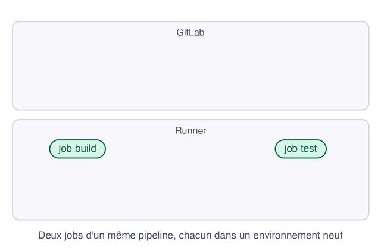

Avec l'executor `docker`, les jobs démarrent chacun dans un conteneur neuf, et rien ne passe de l'un à l'autre sans le demander. Le cache sert à aller plus vite, et l'artefact sert à transmettre un résultat.

**Prérequis** : avoir écrit un pipeline à plusieurs jobs, ce qu'enseigne [Créer son premier pipeline GitLab](https://byte-layers.com/fr/labs/gitlab-first-pipeline).

# Cache ou artefacts : partager des fichiers entre jobs

Les deux déclarent des chemins à conserver, avec une syntaxe proche. Leur rôle est pourtant différent, et les confondre donne des pipelines lents ou instables.

## 1 - Voir la différence en mouvement

L'artefact remonte sur GitLab, qui le remet aux jobs suivants. Le cache est géré par le runner, sur son disque ou un stockage partagé, et ne sert que s'il le retrouve :

## 2 - Choisir entre les deux

| | Cache | Artefact |
|---|---|---|
| Sert à | accélérer, par exemple les dépendances | transmettre un résultat de build, un rapport |
| Disponible | si le runner le retrouve, sans garantie | garanti pour les jobs des stages suivants |
| Durée de vie | selon la configuration du runner | `expire_in`, téléchargeable sur GitLab |
| Exemple | `node_modules/` | `dist/`, `rapport.html` |

Un job ne doit donc jamais échouer parce que le cache est absent : il doit savoir réinstaller ce qui manque. Le test est simple : si le job fonctionne encore en vidant le cache, c'était bien un cache.

## Récap

- Le cache accélère, sans garantie.
- L'artefact transmet un résultat, de façon garantie, aux jobs suivants.
- Un job doit fonctionner sans cache.

> 📖 [Cache et artefacts](https://docs.gitlab.com/ci/caching/#how-cache-is-different-from-artifacts) · [Artefacts de job](https://docs.gitlab.com/ci/jobs/job_artifacts/)
