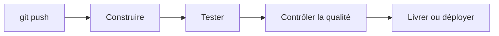

L'intégration continue vérifie automatiquement chaque changement de code, et la livraison continue le rend prêt à déployer. Un pipeline est la suite d'étapes qui fait ce travail à votre place, à chaque envoi.

**Prérequis** : savoir ce qu'est une merge request, ce qu'enseigne [Livrer du code avec les merge requests](https://byte-layers.com/fr/skills/gitlab-merge-requests).

# CI/CD : automatiser les tests et la livraison

Sans automatisation, quelqu'un doit penser à lancer les tests et à déployer, de la même façon, à chaque changement. La **CI/CD** confie ce travail à des machines, qui le refont à l'identique à chaque fois.

## 1 - Intégration, livraison et déploiement continus

Les trois termes désignent trois étendues d'automatisation, chacune incluant la précédente :

| Terme | Ce qui est automatique | La dernière étape vers la production |
|---|---|---|
| Intégration continue (CI) | construire et tester chaque changement | non concernée |
| Livraison continue (*continuous delivery*) | produire une version prête à être déployée | un humain décide |
| Déploiement continu (*continuous deployment*) | déployer après chaque changement validé | automatique |

## 2 - Un pipeline enchaîne des étapes

Un **pipeline** est la description de ce travail, écrite dans un fichier du dépôt. Il se déclenche tout seul, souvent à chaque `git push` :

Si une étape échoue, les suivantes ne se lancent pas : un changement cassé ne va pas plus loin. Comme le pipeline est un fichier versionné, il se relit et se modifie comme le code.

> 💡 **Remarque.** GitLab CI n'est qu'un outil parmi d'autres : GitHub Actions et Jenkins reposent sur les mêmes idées, avec une syntaxe différente.

## Récap

- La CI vérifie chaque changement, la livraison le prépare, et le déploiement continu l'installe.
- Un pipeline décrit ces étapes dans un fichier du dépôt.
- Une étape en échec arrête la suite.

> 📖 [GitLab CI/CD](https://docs.gitlab.com/ci/) · [Livraison et déploiement continus, par Atlassian](https://www.atlassian.com/continuous-delivery/principles/continuous-integration-vs-delivery-vs-deployment)
