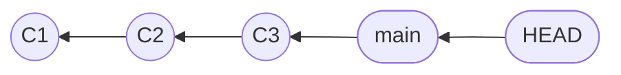

Une branche est un simple pointeur vers un commit, et non une copie du projet, même si vos fichiers changent quand vous passez de l'une à l'autre. C'est ce qui rend sa création instantanée. Vous allez lire le fichier qui se cache derrière une branche.

**Prérequis** : savoir créer et fusionner des branches, ce qu'enseigne [Travailler en parallèle avec les branches](https://byte-layers.com/fr/skills/git-branches-merge), et avoir réglé votre identité Git.

# Une branche est un pointeur

Une **branche** est un simple nom qui désigne un commit, ce qu'on appelle un **pointeur**. Quand vous faites un commit, Git déplace ce nom vers le nouveau commit, et c'est tout.



Dans ce schéma, chaque commit désigne son parent, `main` désigne le dernier commit, et `HEAD` désigne la branche où vous êtes.

## 1 - Lire le fichier d'une branche

Créez un petit dépôt, avec un commit et une branche. Ce sont les commandes du cours en prérequis :

```exec
mkdir -p ~/layers-git/l2-pointer && cd ~/layers-git/l2-pointer && git init -b main
echo '# Runbook' > runbook.md && git add runbook.md && git commit -m "État initial"
git branch feature/x
```

Les branches sont rangées sous `.git/refs/heads`. Affichez le contenu des fichiers de vos deux branches :

```exec
cd ~/layers-git/l2-pointer && cat .git/refs/heads/main .git/refs/heads/feature/x
```

Chaque fichier contient seulement le hash d'un commit, ici le même :

```text
e593b62f634b6f7b97dc44185e92b7a81097efda
e593b62f634b6f7b97dc44185e92b7a81097efda
```

Dans un dépôt neuf comme celui-ci, une branche occupe donc 41 octets sur le disque, quelle que soit la taille du projet : le hash et un retour à la ligne. Git la crée sans copier le moindre fichier, ce qui la rend instantanée.

> 💡 **Remarque.** Sur un dépôt plus ancien, Git peut regrouper ces références dans un seul fichier, et le principe reste le même.

## 2 - Lire HEAD pour savoir où vous êtes

Le fichier `.git/HEAD` indique la branche courante. Lisez-le, placez-vous sur l'autre branche, puis relisez-le :

```exec
cd ~/layers-git/l2-pointer && cat .git/HEAD
cd ~/layers-git/l2-pointer && git switch feature/x && cat .git/HEAD
```

Il pointe d'abord vers `main`, puis vers `feature/x` :

```text
ref: refs/heads/main
Switched to branch 'feature/x'
ref: refs/heads/feature/x
```

Un commit fait sur cette branche déplace `feature/x`, et `main` reste où elle est. Vérifiez-le en faisant un commit, puis en demandant à `git log` où sont les noms :

```exec
cd ~/layers-git/l2-pointer && echo 'Alerte' >> runbook.md && git commit -am "Ajoute une alerte"
cd ~/layers-git/l2-pointer && git log --oneline --all
```

Seule `feature/x` a avancé, et `main` n'a pas bougé :

```text
0aae13d (HEAD -> feature/x) Ajoute une alerte
e593b62 (main) État initial
```

Vous tenez aussi l'explication de deux gestes vus dans le cours. L'avance rapide ne fait que déplacer un pointeur, et supprimer une branche ne supprime que le pointeur, pas les commits.

## 3 - Ranger le dossier de cette manipulation

Ce dossier ne sert plus, et vous pouvez le supprimer depuis votre dossier personnel :

```exec
cd ~ && rm -rf ~/layers-git/l2-pointer
```

## Récap

- Une branche est un nom qui désigne un commit, stocké sous la forme d'un hash.
- Faire un commit déplace le pointeur de la branche courante.
- `HEAD` désigne la branche où vous êtes.
- Une avance rapide déplace un pointeur, et une suppression de branche retire un pointeur.

> 📖 [Les branches en bref, dans le livre Pro Git](https://git-scm.com/book/fr/v2/Les-branches-avec-Git-Les-branches-en-bref) · [Références Git](https://git-scm.com/book/fr/v2/Les-tripes-de-Git-R%C3%A9f%C3%A9rences-Git)
