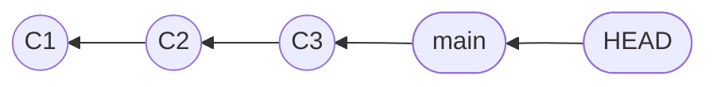
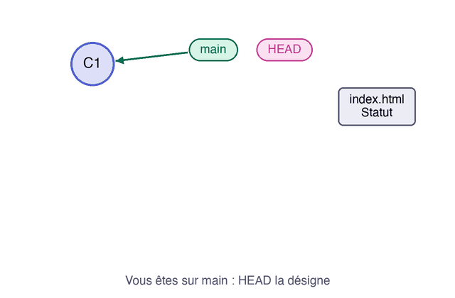

Quand vous commencez un changement, le projet reste instable tant que ce n'est pas terminé. Une **branche** est une ligne d'historique séparée : vous y travaillez sans déranger la branche principale, et vous ne réunissez les deux que lorsque c'est prêt. Techniquement, c'est un nom qui désigne un commit et qui avance à chaque nouveau commit.



Dans ce schéma, chaque commit désigne son parent, c'est-à-dire le commit qui le précède, `main` désigne le dernier commit, et `HEAD` indique la branche où vous êtes.

## 01.1 - Créer le dépôt de départ

Créez un dépôt qui contient une page et un runbook, avec un seul commit. `mkdir -p` crée le dossier, et la construction `cat > fichier <<'EOF'` écrit dans le fichier tout ce qui suit, jusqu'à la ligne `EOF`.

```exec
mkdir -p ~/byte-layers/git/l2 && cd ~/byte-layers/git/l2 && git init -b main
echo '<h1>Statut des services</h1>' > index.html
cat > runbook.md <<'EOF'
# Runbook

Alerte au bout de : 5 minutes
EOF
git add index.html runbook.md && git commit -m "État initial"
```

```verify
D=~/byte-layers/git/l2
if ! git -C "$D" rev-parse HEAD >/dev/null 2>&1; then
  echo "Le dépôt ~/byte-layers/git/l2 n'a pas de commit. Vérifiez votre identité avec git config --global user.name, puis relancez la commande de cette section."
  exit 1
fi
if [ "$(git -C "$D" symbolic-ref --short HEAD)" != "main" ]; then
  echo "Vous devriez être sur la branche main."
  exit 1
fi
echo "Le dépôt de départ est prêt."
```

## 01.2 - Créer une branche et s'y placer

`git branch` sans argument liste les branches, et l'astérisque marque celle où vous êtes :

```exec
cd ~/byte-layers/git/l2 && git branch
```

Vous n'avez pour l'instant qu'une seule branche :

```text
* main
```

Créez une branche pour ajouter l'état de la base de données à la page. Le préfixe `feature/` n'a rien d'obligatoire : c'est une convention répandue, qui range les branches par type de travail.

```exec
cd ~/byte-layers/git/l2 && git branch feature/db
```

Créer une branche ne vous y place pas. Dans un terminal, `git log --oneline` affiche à côté des commits les noms qui pointent vers eux :

```exec
cd ~/byte-layers/git/l2 && git log --oneline
```

Les deux branches désignent le même commit, et `HEAD` indique où vous vous trouvez : toujours sur `main`.

```text
7060bcd (HEAD -> main, feature/db) État initial
```

Placez-vous sur la nouvelle branche :

```exec
cd ~/byte-layers/git/l2 && git switch feature/db
```

Git confirme le changement de branche :

```text
Switched to branch 'feature/db'
```

## 01.3 - Faire un commit sur la branche et voir la différence

Ajoutez une ligne à la page, et enregistrez-la sur cette branche :

```exec
cd ~/byte-layers/git/l2 && echo '<p>Base de données : OK</p>' >> index.html
cd ~/byte-layers/git/l2 && git add index.html && git commit -m "Affiche l'état de la base"
```

Regardez le contenu de la page, qui contient maintenant les deux lignes :

```exec
cd ~/byte-layers/git/l2 && cat index.html
```

Vous retrouvez la ligne ajoutée sous le titre :

```text
<h1>Statut des services</h1>
<p>Base de données : OK</p>
```

Revenez sur `main` et relisez le même fichier :

```exec
cd ~/byte-layers/git/l2 && git switch main
cd ~/byte-layers/git/l2 && cat index.html
```

La ligne ajoutée a disparu de votre dossier :

```text
Switched to branch 'main'
<h1>Statut des services</h1>
```

Rien n'est perdu. Git a simplement remis dans votre dossier les fichiers tels qu'ils sont sur `main`. C'est ce qui permet de passer d'un travail à l'autre sans copier de dossier.

Cette animation reprend ces gestes : `HEAD` change de branche, le commit fait avancer la branche où vous êtes, et le fichier suit.



> ⚠️ **Avant de changer de branche, regardez `git status`.** Si vos changements non enregistrés touchent des fichiers qui diffèrent sur l'autre branche, `git switch` refuse pour ne rien écraser. Enregistrez-les d'abord. Et avant de faire un commit, vérifiez que vous êtes sur la bonne branche : `git status` l'indique sur sa première ligne.

```verify
D=~/byte-layers/git/l2
if [ "$(git -C "$D" symbolic-ref --short HEAD)" != "main" ]; then
  echo "Revenez sur main avec git switch main."
  exit 1
fi
if ! git -C "$D" show feature/db:index.html 2>/dev/null | grep -q "Base de données"; then
  echo "Le commit qui ajoute la base devrait exister sur feature/db."
  exit 1
fi
if grep -q "Base de données" "$D"/index.html; then
  echo "Sur main, index.html ne devrait pas encore contenir cette ligne."
  exit 1
fi
echo "Le changement existe sur feature/db, et main ne le voit pas."
```

> 📖 [`git branch`](https://git-scm.com/docs/git-branch) · [`git switch`](https://git-scm.com/docs/git-switch)
