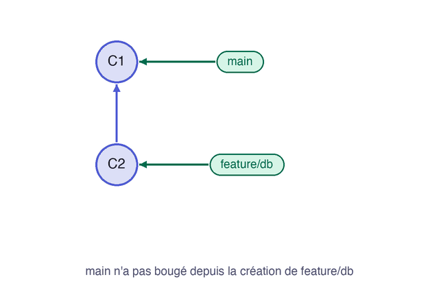

Le travail de `feature/db` est terminé, et il doit rejoindre `main`. C'est le cas le plus simple de la fusion, car `main` n'a pas évolué depuis la création de la branche.

## 02.1 - Voir les deux branches sous forme de graphe

`--all` montre toutes les branches, et `--graph` dessine leurs liens. Cette commande vous servira à chaque étape, gardez-la sous la main :

```exec
cd ~/byte-layers/git/l2 && git log --oneline --all --graph
```

Les commits forment encore une seule ligne, et `feature/db` est simplement en avance d'un commit sur `main` :

```text
* cf259c4 (feature/db) Affiche l'état de la base
* 7060bcd (HEAD -> main) État initial
```

## 02.2 - Fusionner avec git merge

`git merge` amène sur la branche **où vous êtes** le travail de la branche que vous nommez. Vous êtes sur `main` et vous lui amenez `feature/db` :

```exec
cd ~/byte-layers/git/l2 && git merge feature/db
```

Le mot important de la réponse est `Fast-forward` :

```text
Updating 7060bcd..cf259c4
Fast-forward
 index.html | 1 +
 1 file changed, 1 insertion(+)
```

**Fast-forward**, ou « avance rapide », signifie que Git n'a rien eu à réunir : `main` n'avait pas bougé, et Git l'a simplement avancée jusqu'au dernier commit de `feature/db`. Le graphe le montre :

```exec
cd ~/byte-layers/git/l2 && git log --oneline --all --graph
```

Les deux noms désignent maintenant le même commit :

```text
* cf259c4 (HEAD -> main, feature/db) Affiche l'état de la base
* 7060bcd État initial
```

L'animation montre que rien n'est réuni : seul le nom `main` se déplace.



```verify
D=~/byte-layers/git/l2
if ! git -C "$D" merge-base --is-ancestor feature/db main 2>/dev/null; then
  echo "feature/db n'est pas encore fusionnée dans main. Lancez git merge feature/db depuis main."
  exit 1
fi
if ! grep -q "Base de données" "$D"/index.html; then
  echo "index.html devrait maintenant contenir la ligne sur la base de données."
  exit 1
fi
echo "main contient le travail de feature/db."
```

## 02.3 - Supprimer la branche fusionnée

La branche a joué son rôle. La supprimer retire seulement ce nom, et les commits restent dans `main`. L'option `-d` n'accepte de supprimer qu'une branche déjà fusionnée, ce qui vous protège d'une perte :

```exec
cd ~/byte-layers/git/l2 && git branch -d feature/db
```

Git confirme la suppression et rappelle le commit que désignait la branche :

```text
Deleted branch feature/db (was cf259c4).
```

```verify
D=~/byte-layers/git/l2
if git -C "$D" show-ref --verify --quiet refs/heads/feature/db; then
  echo "La branche feature/db existe encore. Lancez git branch -d feature/db."
  exit 1
fi
echo "La branche est supprimée, ses commits restent dans main."
```

> 📖 [`git merge`](https://git-scm.com/docs/git-merge) · [`git log`](https://git-scm.com/docs/git-log)
