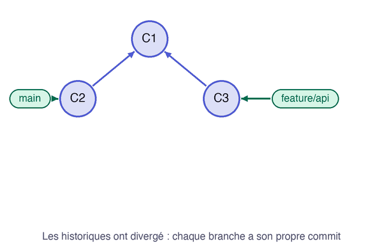

Dans une équipe, `main` avance pendant que vous travaillez. Les deux lignes d'historique **divergent**, et l'avance rapide n'est plus possible : Git doit réellement réunir deux travaux.

## 03.1 - Faire avancer les deux branches séparément

`git switch -c` crée une branche et s'y place d'un coup, ce qui remplace `git branch` suivi de `git switch`. Ajoutez l'état de l'API sur une nouvelle branche :

```exec
cd ~/layers-git/l2 && git switch -c feature/api
cd ~/layers-git/l2 && echo '<p>API : OK</p>' >> index.html
cd ~/layers-git/l2 && git add index.html && git commit -m "Affiche l'état de l'API"
```

Revenez sur `main` et enregistrez-y un autre changement, sur un autre fichier. Il simule le travail d'un collègue arrivé entre-temps :

```exec
cd ~/layers-git/l2 && git switch main
cd ~/layers-git/l2 && echo '## Contacts' >> runbook.md
cd ~/layers-git/l2 && git add runbook.md && git commit -m "Ajoute les contacts"
```

Le graphe dessine maintenant une fourche, puisque chaque branche possède un commit que l'autre n'a pas :

```exec
cd ~/layers-git/l2 && git log --oneline --all --graph
```

Les deux lignes partent du même commit :

```text
* 2623a17 (HEAD -> main) Ajoute les contacts
| * 918ee95 (feature/api) Affiche l'état de l'API
|/  
* cf259c4 Affiche l'état de la base
* 7060bcd État initial
```

## 03.2 - Réunir les deux travaux avec un commit de merge

Fusionnez `feature/api` dans `main`. Git doit cette fois créer un nouveau commit, et il vous propose normalement d'en relire le message dans un éditeur. L'option `--no-edit` accepte directement ce message :

```exec
cd ~/layers-git/l2 && git merge --no-edit feature/api
```

Git ne dit plus `Fast-forward`, et sa réponse nomme la stratégie de fusion utilisée :

```text
Merge made by the 'ort' strategy.
 index.html | 1 +
 1 file changed, 1 insertion(+)
```

Sur le graphe, les deux lignes se rejoignent :

```exec
cd ~/layers-git/l2 && git log --oneline --all --graph
```

Le commit de merge apparaît tout en haut :

```text
*   4a8310c (HEAD -> main) Merge branch 'feature/api'
|\  
| * 918ee95 (feature/api) Affiche l'état de l'API
* | 2623a17 Ajoute les contacts
|/  
* cf259c4 Affiche l'état de la base
* 7060bcd État initial
```

Ce nouveau commit, appelé **commit de merge**, a la particularité d'avoir deux parents, un sur chaque branche. Git a réussi seul parce que les deux changements portaient sur des fichiers différents.

Cette animation montre la création de ce commit à deux parents :



> ⚠️ **Sans `--no-edit`, ce qui est l'usage courant**, Git ouvre un éditeur avec le message proposé. Sauvegardez et fermez-le pour conclure. Sous Vim, tapez `:wq` puis Entrée. Pour utiliser VS Code à la place, réglez une fois pour toutes `git config --global core.editor "code --wait"`.

Supprimez la branche, désormais fusionnée :

```exec
cd ~/layers-git/l2 && git branch -d feature/api
```

```verify
D=~/layers-git/l2
if [ "$(git -C "$D" rev-list --parents -n 1 HEAD | wc -w | tr -d ' ')" != "3" ]; then
  echo "Le dernier commit de main devrait être un commit de merge, avec deux parents."
  exit 1
fi
if ! grep -q "API : OK" "$D"/index.html || ! grep -q "Contacts" "$D"/runbook.md; then
  echo "main devrait contenir les deux travaux : la ligne API et les contacts."
  exit 1
fi
if git -C "$D" show-ref --verify --quiet refs/heads/feature/api; then
  echo "La branche feature/api existe encore. Lancez git branch -d feature/api."
  exit 1
fi
echo "Le commit de merge réunit les deux travaux."
```

## Question

```quiz
prompt: "Quand `git merge` crée-t-il un commit de merge ?"
answers:
  - "Quand les deux branches ont chacune des commits que l'autre n'a pas"
  - "À chaque fusion, sans exception"
  - "Uniquement quand il y a un conflit"
correct: 1
explanation: "Si la branche de destination n'a pas bougé, c'est une avance rapide, sans nouveau commit. Un conflit n'est pas nécessaire pour créer un commit de merge."
```

> 📖 [Branches et fusions : les bases](https://git-scm.com/book/fr/v2/Les-branches-avec-Git-Branches-et-fusions%C2%A0:-les-bases)
