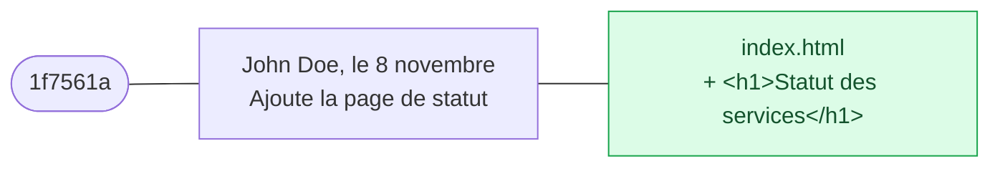
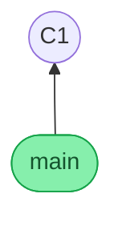
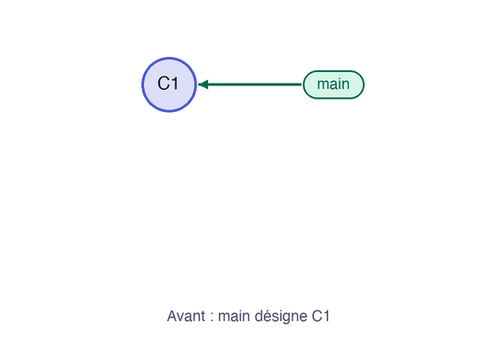

Vous créez maintenant le dépôt du projet `statuspage`, vous y ajoutez la page de statut, et vous en enregistrez une première version. Une commande reviendra sans cesse, `git status`, parce qu'elle dit toujours où vous en êtes.

## 03.1 - Transformer un dossier en dépôt avec git init

Un **dépôt** (en anglais *repository*, ou *repo*) est un dossier dont Git suit l'historique. Créez le dossier avec `mkdir -p`, puis demandez à Git de l'initialiser. Une **branche** est une ligne d'historique, et un dépôt en a au moins une : l'option `-b main` nomme `main` la première. Sur des dépôts plus anciens, vous la verrez souvent nommée `master`.

Dans ce cours, chaque commande commence par `cd ~/byte-layers/git/l1 &&`, pour que le bouton qui l'exécute marche où que soit votre terminal. Quand vous taperez vous-même vos commandes, un seul `cd` dans le dossier suffira pour toute une séance.

```exec
mkdir -p ~/byte-layers/git/l1
cd ~/byte-layers/git/l1 && git init -b main
```

Git confirme qu'il a créé un dépôt vide. Si votre terminal affiche ses messages en français, le sens reste le même que dans ce cours.

```text
Initialized empty Git repository in /home/john/byte-layers/git/l1/.git/
```

Tout l'historique tient dans un dossier caché nommé `.git`, créé à l'instant. L'option `-a` de `ls` montre les fichiers cachés :

```exec
cd ~/byte-layers/git/l1 && ls -a
```

Vous voyez `.git`, ainsi que `.` et `..`, les raccourcis habituels vers le dossier courant et son parent.

```verify
if ! git -C ~/byte-layers/git/l1 rev-parse --git-dir >/dev/null 2>&1; then
  echo "~/byte-layers/git/l1 n'est pas un dépôt Git. Lancez git init dans ce dossier."
  exit 1
fi
if [ "$(git -C ~/byte-layers/git/l1 symbolic-ref --short HEAD)" != "main" ]; then
  echo "La branche n'est pas main. Supprimez ~/byte-layers/git/l1 et relancez git init -b main."
  exit 1
fi
echo "Le dépôt existe, sur la branche main."
```

## 03.2 - Lire l'état du dépôt avec git status

Demandez à Git ce qu'il voit dans ce dépôt encore vide :

```exec
cd ~/byte-layers/git/l1 && git status
```

Il répond qu'il n'y a encore aucune version, et rien à enregistrer :

```text
On branch main

No commits yet

nothing to commit (create/copy files and use "git add" to track)
```

Créez maintenant la page de statut. La commande `echo` écrit un texte, et `>` l'envoie dans un fichier.

```exec
cd ~/byte-layers/git/l1 && echo '<h1>Statut des services</h1>' > index.html
```

Redemandez l'état du dépôt, et regardez ce qui a changé :

```exec
cd ~/byte-layers/git/l1 && git status
```

Git voit le fichier, mais il le classe en *untracked*, c'est-à-dire **non suivi** : il sait qu'il existe, et ne l'enregistrera pas tant que vous ne le lui demanderez pas.

```text
Untracked files:
  (use "git add <file>..." to include in what will be committed)
	index.html
```

## 03.3 - Préparer puis enregistrer avec git add et git commit

Enregistrer une version se fait en deux gestes. `git add` place le fichier dans la **zone de préparation** (en anglais *staging area*, ou *index*), c'est-à-dire la liste de ce qui entrera dans la prochaine version, à ne pas confondre avec le fichier `index.html`. `git commit` enregistre ensuite cette liste. La version enregistrée s'appelle un **commit**. Dans ce cours, « enregistrer » veut toujours dire faire un commit, ce qui n'a rien à voir avec sauvegarder un fichier dans un éditeur.

> ⚠️ **Sous Windows, le message `LF will be replaced by CRLF`** peut s'afficher à partir de maintenant. C'est un avertissement sur les fins de ligne, sans conséquence dans ce cours.

Préparez le fichier :

```exec
cd ~/byte-layers/git/l1 && git add index.html
```

`git status` confirme que le fichier est prêt à entrer dans le prochain commit :

```exec
cd ~/byte-layers/git/l1 && git status
```

Le fichier figure désormais dans la section des changements à enregistrer :

```text
Changes to be committed:
  (use "git rm --cached <file>..." to unstage)
	new file:   index.html
```

Enregistrez maintenant ce commit. L'option `-m` donne son **message**, la phrase qui dit ce que cette version apporte, plutôt qu'un simple « modifs ». Gardez les guillemets doubles, car une apostrophe française poserait problème entre des apostrophes simples :

```exec
cd ~/byte-layers/git/l1 && git commit -m "Ajoute la page de statut"
```

Git affiche la branche, le début de l'identifiant du commit, son message, et ce qu'il contient. L'identifiant, ici `1f7561a`, sera différent chez vous :

```text
[main (root-commit) 1f7561a] Ajoute la page de statut
 1 file changed, 1 insertion(+)
 create mode 100644 index.html
```

Vous venez d'enregistrer votre premier commit, sur la branche `main`.

> ⚠️ **Si Git vous ouvre un éditeur inconnu** : c'est que vous avez lancé `git commit` sans `-m`, et Git vous demande d'écrire le message. S'il s'agit de Vim, tapez `:q!` puis Entrée pour en sortir sans créer de commit, puis relancez la commande avec `-m`.

## 03.4 - Voir ce qu'un commit a enregistré

Regardez ce que contient votre commit. `git show` affiche le dernier commit. Si la sortie remplit l'écran, appuyez sur `q` pour la quitter.

```exec
cd ~/byte-layers/git/l1 && git show
```

Le haut de la réponse dit qui a fait ce commit, quand et pourquoi. Le bas, appelé **diff**, montre ce qui a changé : chaque ligne ajoutée commence par `+`.

```text
commit 1f7561a1e446c53ec19074866f143b7841a1a7e3 (HEAD -> main)
Author: John Doe <john.doe@example.com>
Date:   Sun Nov 8 22:56:07 2026 +0100

    Ajoute la page de statut

diff --git a/index.html b/index.html
new file mode 100644
index 0000000..94d6643
--- /dev/null
+++ b/index.html
@@ -0,0 +1 @@
+<h1>Statut des services</h1>
```

Ce schéma résume ce que représente votre commit :



Le code `1f7561a` est le numéro de ce commit, et il sera différent chez vous. Git le calcule à partir du contenu du commit. Pour rester lisibles, les schémas de ce parcours remplacent souvent ces numéros par `C1`, `C2`, `C3` : retenez qu'un vrai commit porte toujours un numéro comme celui-ci.

```verify
D=~/byte-layers/git/l1
if ! git -C "$D" rev-parse HEAD >/dev/null 2>&1; then
  echo "Il n'y a encore aucun commit. Lancez git add, puis git commit."
  exit 1
fi
if ! git -C "$D" ls-tree --name-only HEAD | grep -qx index.html; then
  echo "index.html n'est pas dans votre commit. Lancez git add index.html, puis git commit."
  exit 1
fi
echo "Votre premier commit contient index.html."
```

## 03.5 - Votre commit et votre première branche

Votre dépôt se résume pour l'instant à un seul commit, qui se situe sur une branche nommée `main` :



Dans Git, les branches permettent d'organiser le contenu et le travail, et vous apprendrez à en créer dans un prochain cours. Une branche fonctionne comme un **pointeur** : elle désigne toujours le commit le plus récent de sa lignée.

Regardez-le en pratique, avec un deuxième commit. Ajoutez une ligne à la page, et regardez ce que Git voit, avant tout enregistrement :

```exec
cd ~/byte-layers/git/l1 && echo '<p>Tous les services fonctionnent</p>' >> index.html
cd ~/byte-layers/git/l1 && git diff
```

La commande `git diff` montre ce qui a changé depuis le dernier commit, et la nouvelle ligne est précédée d'un `+` :

```text
diff --git a/index.html b/index.html
index 94d6643..b4d0979 100644
--- a/index.html
+++ b/index.html
@@ -1 +1,2 @@
 <h1>Statut des services</h1>
+<p>Tous les services fonctionnent</p>
```

Enregistrez ce changement, puis affichez l'historique. L'option `--oneline` résume chaque commit en une ligne :

```exec
cd ~/byte-layers/git/l1 && git add index.html && git commit -m "Ajoute le résumé de l'état"
cd ~/byte-layers/git/l1 && git log --oneline
```

Le nouveau commit apparaît en haut, et le repère `main` est maintenant sur lui :

```text
0d999d1 (HEAD -> main) Ajoute le résumé de l'état
1f7561a Ajoute la page de statut
```

Cette animation montre ce qui vient de se passer. Le commit `C2` est créé, il désigne son parent `C1`, puis `main` avance sur lui :



```verify
D=~/byte-layers/git/l1
if [ "$(git -C "$D" rev-list --count HEAD 2>/dev/null)" -lt 2 ]; then
  echo "Votre historique devrait contenir deux commits. Lancez git add, puis git commit."
  exit 1
fi
echo "main désigne votre deuxième commit."
```

## Questions

```quiz
title: "Votre premier commit"
tracksProgress: false
questions:
  - prompt: "Que fait `git add index.html` ?"
    answers:
      - "Il enregistre une nouvelle version du fichier dans l'historique"
      - "Il place le fichier dans la zone de préparation du prochain commit"
      - "Il envoie le fichier sur un serveur"
    correct: 2
    explanation: "`git add` prépare, et c'est `git commit` qui enregistre. Aucun des deux ne parle à un serveur."
  - prompt: "Où Git range-t-il l'historique d'un dépôt ?"
    answers:
      - "Sur un serveur GitHub ou GitLab"
      - "Dans le fichier ~/.gitconfig"
      - "Dans le dossier caché .git, à la racine du dépôt"
    correct: 3
    explanation: "Tout l'historique est dans `.git`. `~/.gitconfig` ne contient que vos réglages."
```

> 📖 [`git init`](https://git-scm.com/docs/git-init) · [`git status`](https://git-scm.com/docs/git-status) · [`git add`](https://git-scm.com/docs/git-add) · [`git commit`](https://git-scm.com/docs/git-commit)
