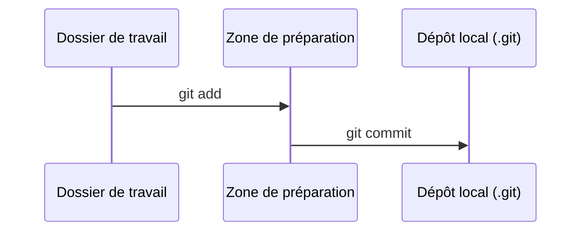
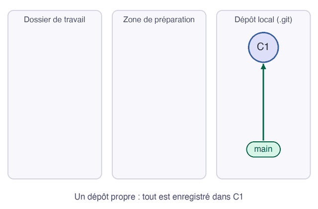

Vous venez de faire deux commits avec `git add` puis `git commit`. Voici le plan d'ensemble : les endroits par lesquels passe un changement sur votre machine, depuis votre éditeur jusqu'à l'historique.

## 04.1 - Les trois zones de Git sur votre machine

Git range votre travail dans trois zones, et chaque commande fait passer des changements de l'une à l'autre :

| Zone | Son nom en anglais | Ce qu'elle contient | Où elle se trouve |
|---|---|---|---|
| Le dossier de travail | *working directory* ou *working tree* | vos fichiers, tels que vous les éditez | le dossier du projet |
| La zone de préparation | *staging area* ou *index* | la liste de ce qui entrera dans le prochain commit | le fichier `.git/index` |
| Le dépôt local | *repository* | tous vos commits | le dossier `.git` |

Vous pouvez constater que les deux dernières existent bien, en listant le contenu de `.git` :

```exec
cd ~/layers-git/l1 && ls .git
```

Le fichier `index` et le dossier `objects`, où sont rangés les commits, figurent dans la réponse :

```text
COMMIT_EDITMSG  HEAD  config  description  hooks  index  info  logs  objects  refs
```

## 04.2 - Le parcours d'un changement, du dossier de travail au dépôt local

Ce schéma montre les deux commandes que vous venez d'utiliser, et la zone que chacune fait franchir à vos changements :



Une quatrième zone s'ajoutera quand vous travaillerez à plusieurs : le **dépôt distant** (en anglais *remote*), une copie du dépôt sur un serveur, comme GitHub ou GitLab.

## 04.3 - Les états d'un fichier dans git status

`git status` vous dit toujours où se trouvent vos changements, avec ces mentions :

| Ce qu'affiche `git status` | L'état du fichier | Où en est le changement |
|---|---|---|
| `Untracked files` | non suivi | dans le dossier de travail, Git ne le suit pas encore |
| `Changes not staged for commit` | modifié | dans le dossier de travail |
| `Changes to be committed` | préparé | dans la zone de préparation |
| `nothing to commit, working tree clean` | enregistré | dans le dépôt local |

## 04.4 - Un cycle complet en animation

Cette animation résume un cycle de travail complet sur votre machine : deux fichiers modifiés et préparés, l'un retiré de la préparation, puis un commit avec le premier seulement.



## Questions

```quiz
title: "Le cycle de vie"
tracksProgress: false
questions:
  - prompt: "Vous venez de lancer `git add runbook.md`. Où se trouve maintenant ce changement ?"
    answers:
      - "Dans le dépôt distant"
      - "Dans la zone de préparation"
      - "Dans un nouveau commit"
    correct: 2
    explanation: "`git add` prépare le changement. Il entrera dans un commit au prochain `git commit`."
  - prompt: "Quelle commande enregistre le contenu de la zone de préparation dans le dépôt local ?"
    answers:
      - "git status"
      - "git add"
      - "git commit"
    correct: 3
    explanation: "`git add` remplit la zone de préparation, et `git commit` en fait un commit dans le dépôt local."
```

> 📖 [Rudiments de Git, dans le livre Pro Git](https://git-scm.com/book/fr/v2/D%C3%A9marrage-rapide-Rudiments-de-Git)
