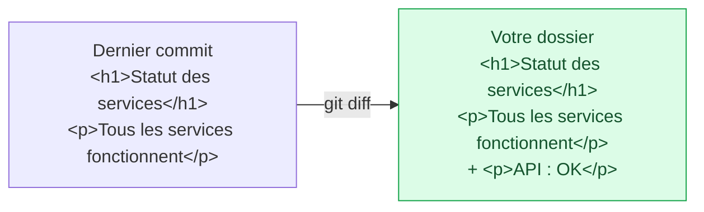

Vous connaissez maintenant les zones de Git, et vous allez vous en servir. Dans la vraie vie, vous modifiez plusieurs fichiers pour des raisons différentes avant de penser à enregistrer. La zone de préparation sert justement à séparer ces changements, pour que chaque commit raconte une seule chose.

## 05.1 - Modifier deux fichiers pour deux raisons différentes

Ajoutez un runbook, la fiche des procédures à suivre en cas d'incident, et faites apparaître l'API sur la page de statut. Le simple `>` crée ou remplace un fichier, alors que `>>` ajoute une ligne à la fin :

```exec
cd ~/layers-git/l1 && echo '# Runbook' > runbook.md
cd ~/layers-git/l1 && echo '<p>API : OK</p>' >> index.html
```

Regardez comment Git classe ces deux changements :

```exec
cd ~/layers-git/l1 && git status
```

Le fichier `index.html`, déjà suivi, est *modified*, et le fichier `runbook.md`, tout neuf, est *untracked* :

```text
Changes not staged for commit:
  (use "git add <file>..." to update what will be committed)
  (use "git restore <file>..." to discard changes in working directory)
	modified:   index.html

Untracked files:
  (use "git add <file>..." to include in what will be committed)
	runbook.md
```

La commande `git restore` que suggère Git annule un changement. Elle sera au programme d'un prochain cours, consacré à réparer ses erreurs.

## 05.2 - Lire les lignes modifiées avec git diff

`git diff` montre ce que vous avez changé dans les fichiers suivis et pas encore préparés :

```exec
cd ~/layers-git/l1 && git diff
```

Les premières lignes désignent le fichier, la ligne `@@` situe le passage, et ensuite les lignes précédées de `+` sont ajoutées, celles précédées de `-` retirées. Si la sortie remplit l'écran, appuyez sur `q` pour la quitter.

```text
diff --git a/index.html b/index.html
index b4d0979..38d39a3 100644
--- a/index.html
+++ b/index.html
@@ -1,2 +1,3 @@
 <h1>Statut des services</h1>
 <p>Tous les services fonctionnent</p>
+<p>API : OK</p>
```

`runbook.md` n'apparaît pas ici, puisque Git ne le suit pas encore.

Ce schéma compare les deux versions d'`index.html` que `git diff` met face à face :



Quand une ligne est modifiée plutôt qu'ajoutée, Git affiche l'ancienne version précédée de `-`, puis la nouvelle précédée de `+`, comme dans cet exemple, que vous n'avez pas à reproduire :

```text
-Alerte au bout de : 5 minutes
+Alerte au bout de : 10 minutes
```

## 05.3 - Faire un commit par intention, avec un commit partiel

Le runbook et l'affichage de l'API sont deux sujets : on parle d'un **commit partiel** quand on n'enregistre qu'une partie des changements en cours. Enregistrez-les séparément, en commençant par préparer le runbook seul.

```exec
cd ~/layers-git/l1 && git add runbook.md
```

`git status` montre alors les deux états côte à côte, ce qui entrera dans le commit et ce qui restera à l'écart :

```exec
cd ~/layers-git/l1 && git status
```

La sortie sépare bien les deux fichiers :

```text
Changes to be committed:
  (use "git restore --staged <file>..." to unstage)
	new file:   runbook.md

Changes not staged for commit:
  (use "git add <file>..." to update what will be committed)
  (use "git restore <file>..." to discard changes in working directory)
	modified:   index.html
```

Avant d'enregistrer, vous pouvez relire exactement ce qui entrera dans le commit. `git diff` seul ne montre toujours pas le runbook, et il faut lui ajouter `--staged` pour voir le contenu de la zone de préparation :

```exec
cd ~/layers-git/l1 && git diff --staged
```

Enregistrez maintenant le runbook dans son propre commit :

```exec
cd ~/layers-git/l1 && git commit -m "Ajoute le runbook"
```

Le changement sur `index.html` est resté dans votre dossier, sans être enregistré. Préparez-le et enregistrez-le à son tour, dans son propre commit :

```exec
cd ~/layers-git/l1 && git add index.html
cd ~/layers-git/l1 && git commit -m "Affiche l'état de l'API"
```

```verify
D=~/layers-git/l1
SEUL_R=0; SEUL_I=0
for C in $(git -C "$D" rev-list HEAD); do
  L=$(git -C "$D" show --name-only --format= "$C")
  [ "$L" = "runbook.md" ] && SEUL_R=$((SEUL_R+1))
  [ "$L" = "index.html" ] && SEUL_I=$((SEUL_I+1))
done
if [ "$SEUL_R" -lt 1 ]; then
  echo "Il manque un commit qui contient runbook.md, et lui seul."
  exit 1
fi
if [ "$SEUL_I" -lt 3 ]; then
  echo "Il manque un commit qui ne contient que le changement de index.html."
  exit 1
fi
if [ -n "$(git -C "$D" status --porcelain)" ]; then
  echo "Il reste des changements non enregistrés : git status vous dira lesquels."
  exit 1
fi
echo "Deux commits, deux intentions, et plus rien en attente."
```

> 💡 **Remarque : un commit partiel à l'intérieur d'un fichier.** `git add -p fichier` vous présente chaque bloc de changements et vous demande lequel préparer : `y` pour oui, `n` pour non. Vous pouvez ainsi enregistrer seulement une partie d'un fichier.

## 05.4 - Regarder dans chaque zone avec git diff et git log

Trois commandes permettent de regarder dans chacune des zones du cycle de vie :

| Commande | Ce qu'elle montre |
|---|---|
| `git diff` | ce qui n'est pas encore préparé |
| `git diff --staged` | ce qui entrera dans le prochain commit |
| `git log` | ce qui est enregistré |

## Questions

```quiz
title: "La zone de préparation"
tracksProgress: false
questions:
  - prompt: "Vous avez préparé runbook.md avec git add. Que montre `git diff` sans option ?"
    answers:
      - "Les changements des fichiers suivis qui ne sont pas encore préparés"
      - "Le contenu de la zone de préparation"
      - "La liste de tous les commits"
    correct: 1
    explanation: "Pour voir ce qui est préparé, il faut `git diff --staged`."
  - prompt: "Pourquoi séparer deux changements dans deux commits ?"
    answers:
      - "Parce que Git refuse deux fichiers dans un même commit"
      - "Pour réduire la taille du dépôt"
      - "Pour que chaque commit raconte une seule chose, et puisse être relu ou annulé seul"
    correct: 3
    explanation: "Git accepte autant de fichiers que vous voulez dans un commit. C'est une bonne pratique, pour vos collègues et pour vous dans six mois."
```

> 📖 [`git diff`](https://git-scm.com/docs/git-diff) · [Enregistrer des modifications dans le dépôt](https://git-scm.com/book/fr/v2/Les-bases-de-Git-Enregistrer-des-modifications-dans-le-d%C3%A9p%C3%B4t)
