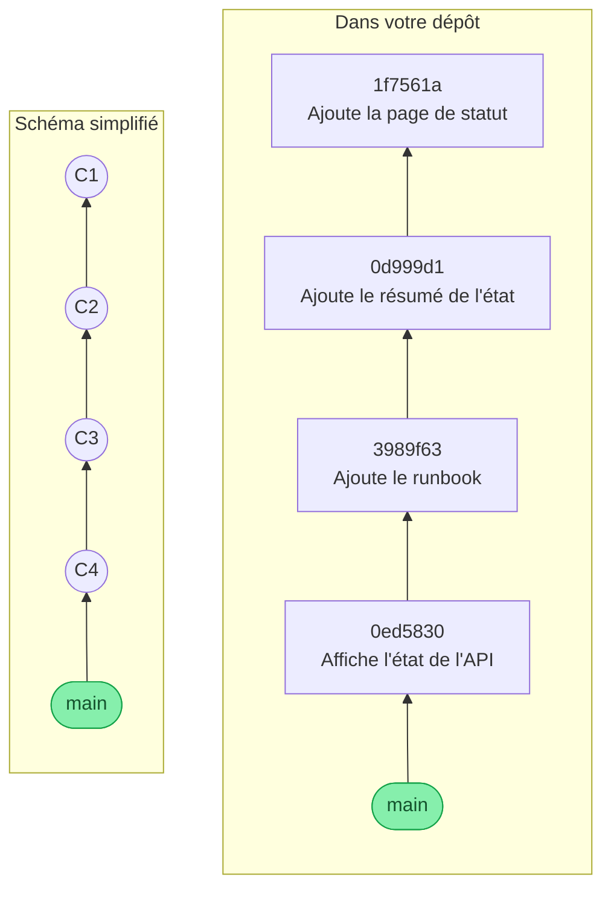

Vous avez maintenant quatre commits. Enregistrer n'a d'intérêt que si l'on peut relire : cette étape vous apprend à parcourir l'historique et à regarder le détail d'une version.

## 06.1 - Lister les commits avec git log

`git log` affiche les commits du plus récent au plus ancien :

```exec
cd ~/layers-git/l1 && git log
```

Chaque commit montre son identifiant complet, son auteur, sa date et son message. Si la liste dépasse l'écran, les flèches la font défiler et `q` la quitte. Le long code hexadécimal s'appelle le **hash** du commit, et il l'identifie de façon unique. La mention `HEAD -> main` dit que vous êtes sur la branche `main`, et que ce commit en est le dernier.

```text
commit 0ed583058461204f43cae99d92c0e0e78ae48bfa (HEAD -> main)
Author: John Doe <john.doe@example.com>
Date:   Sun Nov 8 22:56:10 2026 +0100

    Affiche l'état de l'API
```

L'option `--oneline` résume chaque commit en une ligne, et c'est la forme qu'on utilise le plus souvent :

```exec
cd ~/layers-git/l1 && git log --oneline
```

Les sept premiers caractères du hash suffisent à désigner un commit, et ils seront différents chez vous :

```text
0ed5830 (HEAD -> main) Affiche l'état de l'API
3989f63 Ajoute le runbook
0d999d1 Ajoute le résumé de l'état
1f7561a Ajoute la page de statut
```

Lus de bas en haut, ces messages racontent la vie du projet. C'est pour cela qu'un bon message dit ce que le commit apporte.

Voici votre historique sous deux formes. À gauche, le schéma simplifié qu'utilise ce parcours. À droite, les mêmes commits avec leurs vrais numéros. Chaque commit désigne celui qui le précède, et `main` a avancé à chaque nouveau commit :



Pour voir ce mécanisme s'animer, essayez le premier niveau de la **Séquence d'introduction** de [Learn Git Branching](https://learngitbranching.js.org/?locale=fr_FR), qui dessine le graphe à chaque `git commit`.

## 06.2 - Regarder le détail d'un commit avec git show

Vous avez déjà utilisé `git show` sur votre premier commit. Sans argument, il montre le dernier :

```exec
cd ~/layers-git/l1 && git show
```

Vous y retrouvez la ligne ajoutée à `index.html`. Pour regarder un commit plus ancien, donnez-lui son hash. Dans le résultat de `git log --oneline`, copiez le hash de la dernière ligne, celui de votre tout premier commit, et placez-le après `git show`, en remplaçant celui de cet exemple :

```bash
git show 1f7561a
```

Vous voyez le contenu du tout premier commit, celui qui a créé `index.html`.

```verify
D=~/layers-git/l1
N=$(git -C "$D" rev-list --count HEAD 2>/dev/null)
if [ -z "$N" ] || [ "$N" -lt 4 ]; then
  echo "Votre historique devrait contenir au moins quatre commits. Reprenez la création de vos commits."
  exit 1
fi
echo "Votre historique contient $N commits."
```

## Question

```quiz
prompt: "Quelle commande affiche les lignes modifiées par un commit précis ?"
answers:
  - "git status suivi de son hash"
  - "git show suivi de son hash"
  - "git add suivi de son hash"
correct: 2
explanation: "`git status` décrit l'état présent, et `git add` prépare un fichier. `git show` lit un commit de l'historique."
```

> 📖 [`git log`](https://git-scm.com/docs/git-log) · [`git show`](https://git-scm.com/docs/git-show)
