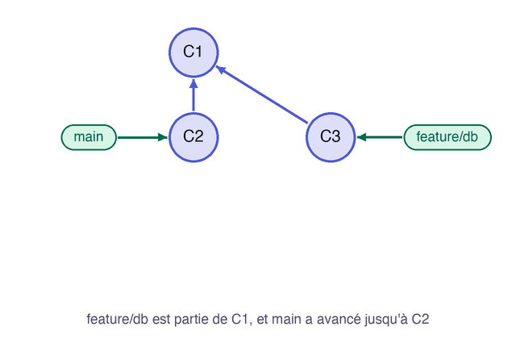

Votre branche est partie d'un commit de `main`, et `main` a avancé depuis. Vous savez déjà réunir les deux avec un merge. Le **rebase** propose une autre réponse : il rejoue vos commits au-dessus de la dernière version de `main`, comme si vous veniez de commencer.

## 01.1 - Créer un dépôt, un serveur et une branche en retard

Ce dépôt a une branche `feature/db` déjà publiée, et un commit sur `main` arrivé après sa création :

```exec
mkdir -p ~/byte-layers/git/l4-rebase/depot && cd ~/byte-layers/git/l4-rebase/depot && git init -b main
echo '<h1>Statut des services</h1>' > index.html && echo '# Runbook' > runbook.md
git add index.html runbook.md && git commit -m "État initial"
git init --bare -b main ../serveur.git
git remote add origin ../serveur.git
git push -u origin main
git switch -c feature/db && echo 'Base : OK' > db.txt && git add db.txt && git commit -m "Ajoute l'état de la base"
git push -u origin feature/db
git switch main && echo 'Alerte' >> runbook.md && git commit -am "Complète le runbook"
```

Regardez le graphe, qui dessine une fourche :

```exec
cd ~/byte-layers/git/l4-rebase/depot && git log --oneline --all --graph
```

Votre branche et `main` ont chacune un commit que l'autre n'a pas :

```text
* c433ca9 (HEAD -> main) Complète le runbook
| * 7a6f809 (origin/feature/db, feature/db) Ajoute l'état de la base
|/  
* 1fcdeec (origin/main) État initial
```

```verify
D=~/byte-layers/git/l4-rebase/depot
if ! git -C "$D" show-ref --verify --quiet refs/heads/feature/db; then
  echo "La branche feature/db n'existe pas. Vérifiez votre identité avec git config --global user.name, puis relancez la commande de cette section."
  exit 1
fi
echo "Le dépôt de départ est prêt."
```

## 01.2 - Rejouer ses commits sur main avec git rebase

Placez-vous sur la branche à déplacer, puis nommez celle sur laquelle la replacer :

```exec
cd ~/byte-layers/git/l4-rebase/depot && git switch feature/db
cd ~/byte-layers/git/l4-rebase/depot && git rebase main
```

Git confirme avoir rejoué votre commit :

```text
Successfully rebased and updated refs/heads/feature/db.
```

Le graphe a changé de forme :

```exec
cd ~/byte-layers/git/l4-rebase/depot && git log --oneline --all --graph
```

Vos commits s'alignent maintenant sur ceux de `main` :

```text
* b919324 (HEAD -> feature/db) Ajoute l'état de la base
* c433ca9 (main) Complète le runbook
| * 7a6f809 (origin/feature/db) Ajoute l'état de la base
|/  
* 1fcdeec (origin/main) État initial
```

Votre branche suit maintenant `main` en ligne droite. Comparez aussi les hash : `7a6f809` est devenu `b919324`. Le rebase ne déplace pas un commit, il en **crée un nouveau** avec les mêmes modifications, car le parent a changé. L'ancien commit reste visible ici parce que `origin/feature/db` pointe encore dessus.

Cette animation montre ce qui vient de se passer :



> 💡 **Remarque.** En équipe, votre `main` locale peut être en retard. Lancez d'abord `git fetch`, puis `git rebase origin/main`.

```verify
D=~/byte-layers/git/l4-rebase/depot
if ! git -C "$D" merge-base --is-ancestor main feature/db; then
  echo "feature/db n'est pas au-dessus de main. Lancez git rebase main depuis feature/db."
  exit 1
fi
if [ "$(git -C "$D" rev-list --merges feature/db | wc -l | tr -d ' ')" != "0" ]; then
  echo "feature/db contient un commit de merge : utilisez git rebase plutôt que git merge."
  exit 1
fi
echo "La branche est replacée au-dessus de main."
```

> 📖 [`git rebase`](https://git-scm.com/docs/git-rebase)
