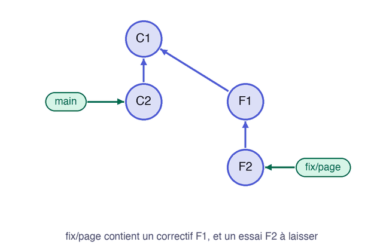

Un correctif se trouve sur une branche dont vous ne voulez pas le reste. `git cherry-pick` rejoue un seul commit, désigné par son hash, sur la branche où vous êtes.

## 04.1 - Créer une branche avec un commit utile et un commit à laisser

La branche `fix/page` contient un correctif, puis un essai sans intérêt :

```exec
cd ~/layers-git/l4-rebase/depot && git switch main
cd ~/layers-git/l4-rebase/depot && git switch -c fix/page
cd ~/layers-git/l4-rebase/depot && echo '<p>Pied de page</p>' >> index.html && git commit -am "Corrige la page"
cd ~/layers-git/l4-rebase/depot && echo 'essai' > essai.txt && git add essai.txt && git commit -m "Ajoute un essai"
cd ~/layers-git/l4-rebase/depot && git log --oneline -n 2
```

## 04.2 - Reporter le correctif sur main avec git cherry-pick

Revenez sur `main`, et reportez uniquement le correctif. En temps normal, vous copieriez son hash depuis `git log`. Ici, `fix/page~1` désigne le commit juste avant le dernier de cette branche, ce qui marche à l'identique chez vous :

```exec
cd ~/layers-git/l4-rebase/depot && git switch main
cd ~/layers-git/l4-rebase/depot && git cherry-pick fix/page~1
```

Git crée un nouveau commit sur `main`, avec les mêmes modifications et un autre hash :

```text
[main 9cb21ef] Corrige la page
 Date: Sun Nov 8 20:33:36 2026 +0100
 1 file changed, 1 insertion(+)
```

`main` contient le correctif, sans `essai.txt` :

```exec
cd ~/layers-git/l4-rebase/depot && ls
```

Le cas le plus courant est celui d'un correctif à reporter sur une ancienne version encore maintenue. Cette animation montre la copie du seul commit choisi :



```verify
D=~/layers-git/l4-rebase/depot
if ! git -C "$D" show main:index.html | grep -q "Pied de page"; then
  echo "main ne contient pas le correctif. Lancez git cherry-pick fix/page~1 depuis main."
  exit 1
fi
if git -C "$D" show main:essai.txt >/dev/null 2>&1; then
  echo "main ne devrait pas contenir essai.txt."
  exit 1
fi
echo "Le correctif est sur main, sans l'essai."
```

> 💡 **Pour aller plus loin : le rebase interactif.** `git rebase -i HEAD~3` ouvre la liste de vos trois derniers commits, pour les réordonner, les fusionner avec `squash` ou en changer le message. Il s'utilise avant de publier, pour présenter un historique propre. Learn Git Branching propose un exercice dessus, dans la section **Déplacer le travail**.

## 04.3 - Ranger le dossier de ce cours

Ce dossier ne servira plus, et vous pouvez le supprimer depuis votre dossier personnel. `rm -rf` efface le dossier et son contenu sans demander de confirmation :

```exec
cd ~ && rm -rf ~/layers-git/l4-rebase
```

```verify
if [ -e ~/layers-git/l4-rebase ]; then
  echo "Le dossier ~/layers-git/l4-rebase existe encore."
  exit 1
fi
echo "Le dossier est supprimé."
```

## Récap

- `git rebase main` rejoue vos commits au-dessus de `main`, et crée de nouveaux commits.
- Ne rebasez pas une branche sur laquelle d'autres personnes travaillent.
- Pour publier une branche rebasée, utilisez `git push --force-with-lease`.
- Un conflit de rebase se conclut par `git add`, puis `git rebase --continue`.
- `git cherry-pick` reporte un commit précis sur la branche où vous êtes.

Pour vous tester sans guide, après avoir aussi suivi [Annuler ses erreurs avec Git](https://byte-layers.com/fr/skills/git-undo), faites le challenge [Réparer un dépôt, sans guide](https://byte-layers.com/fr/challenges/git-repair-challenge).

> 📖 [`git cherry-pick`](https://git-scm.com/docs/git-cherry-pick) · [Learn Git Branching](https://learngitbranching.js.org/?locale=fr_FR)
