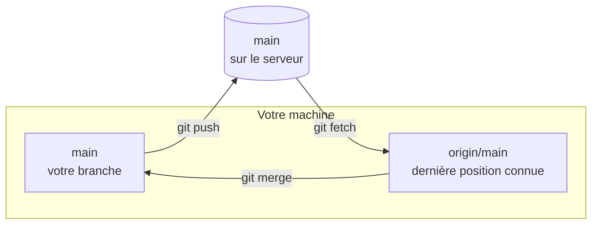

`origin/main` est une copie locale de la position de `main` sur le serveur, mise à jour uniquement quand votre dépôt le contacte. Ce détail explique pourquoi `git status` peut annoncer que tout est à jour alors qu'un collègue vient de publier.

**Prérequis** : savoir utiliser `git push`, `git fetch` et `git pull`, ce qu'enseigne [Partager son travail avec un dépôt distant](https://byte-layers.com/fr/skills/git-remotes), et avoir réglé votre identité Git.

# Main et origin/main : deux branches différentes

Une **branche de suivi distante** (en anglais *remote-tracking branch*) est un nom comme `origin/main`, que Git tient à jour sur votre machine. Il existe donc trois positions à ne pas confondre :



`git pull` enchaîne les flèches `git fetch` et `git merge`.

## 1 - Comparer origin/main à la vraie position du serveur

Créez un serveur local et votre dépôt, publié dessus. Ce sont les commandes du cours en prérequis :

```exec
mkdir -p ~/byte-layers/git/l3-tracking/moi && cd ~/byte-layers/git/l3-tracking/moi && git init -b main
echo '# Runbook' > runbook.md && git add runbook.md && git commit -m "État initial"
git init --bare -b main ../serveur.git
git remote add origin ../serveur.git
git push -u origin main
```

Un collègue clone ce dépôt, ajoute un commit et le publie :

```exec
cd ~/byte-layers/git/l3-tracking && git clone serveur.git collegue
cd ~/byte-layers/git/l3-tracking/collegue && echo 'Alerte' >> runbook.md && git commit -am "Ajoute une alerte" && git push
```

De votre côté, `origin/main` n'a pas bougé. `git rev-parse` affiche le hash, l'identifiant du commit, désigné par un nom. `git ls-remote` interroge réellement le serveur, sans mettre `origin/main` à jour :

```exec
cd ~/byte-layers/git/l3-tracking/moi && git rev-parse origin/main
cd ~/byte-layers/git/l3-tracking/moi && git ls-remote origin main
```

Les deux hash sont différents : votre mémoire du serveur est en retard. `git status` ne le sait pas encore, et annonce que tout est à jour :

```exec
cd ~/byte-layers/git/l3-tracking/moi && git status
```

Mettez cette mémoire à jour avec `git fetch`, puis relancez la première commande et `git status` :

```exec
cd ~/byte-layers/git/l3-tracking/moi && git fetch
cd ~/byte-layers/git/l3-tracking/moi && git rev-parse origin/main
cd ~/byte-layers/git/l3-tracking/moi && git status
```

Le hash d'`origin/main` est maintenant celui du serveur, et votre branche `main` n'a pas bougé. Vous comprenez maintenant le message `behind` de `git status` : il compare `main` à `origin/main`.

## 2 - Ranger le dossier de cette manipulation

Ce dossier ne sert plus, et vous pouvez le supprimer depuis votre dossier personnel :

```exec
cd ~ && rm -rf ~/byte-layers/git/l3-tracking
```

## Récap

- `main` est votre branche, `origin/main` est la dernière position connue de celle du serveur.
- Seules les commandes qui contactent le serveur mettent `origin/main` à jour, comme `git fetch`, `git pull` et `git push`.
- `git status` compare `main` à `origin/main`, sans contacter le serveur.

> 📖 [Branches de suivi à distance, dans le livre Pro Git](https://git-scm.com/book/fr/v2/Les-branches-avec-Git-Branches-de-suivi-%C3%A0-distance)
