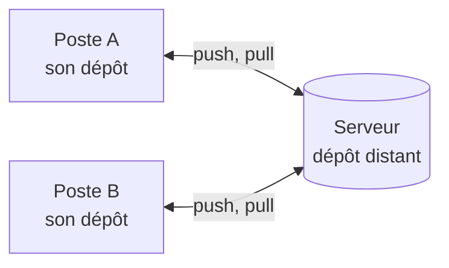

Jusqu'ici, votre historique ne vivait que sur votre machine. Pour travailler à plusieurs, l'équipe se met d'accord sur un dépôt de référence, placé sur un serveur et appelé le **dépôt distant** (en anglais *remote*). Chacun garde son propre dépôt, et échange avec ce serveur, comme le montre ce schéma.



## 01.1 - Créer le projet sur le premier poste

Commencez comme d'habitude, avec un dépôt local et un commit. Le dossier `poste-a` représente la machine de la première personne, et c'est vous :

```exec
mkdir -p ~/layers-git/l3/poste-a && cd ~/layers-git/l3/poste-a && git init -b main
echo '<h1>Statut des services</h1>' > index.html
git add index.html && git commit -m "Ajoute la page de statut"
```

```verify
D=~/layers-git/l3/poste-a
if ! git -C "$D" rev-parse HEAD >/dev/null 2>&1; then
  echo "Le dépôt poste-a n'a pas de commit. Vérifiez votre identité avec git config --global user.name, puis relancez la commande."
  exit 1
fi
echo "Le dépôt du premier poste a son commit."
```

## 01.2 - Créer un dépôt nu qui joue le rôle du serveur

Sur GitHub ou GitLab, c'est le bouton « nouveau projet » qui fait ce travail. Ici, vous créez vous-même ce dépôt dans un dossier, avec l'option `--bare`. Un **dépôt nu** (*bare repository*) contient uniquement l'historique, sans fichiers de travail, puisque personne ne travaille directement sur un serveur :

```exec
git init --bare -b main ~/layers-git/l3/serveur.git
```

Git confirme la création. L'extension `.git` est une convention pour les dépôts nus :

```text
Initialized empty Git repository in /home/john/layers-git/l3/serveur.git/
```

```verify
if [ "$(git -C ~/layers-git/l3/serveur.git rev-parse --is-bare-repository 2>/dev/null)" != "true" ]; then
  echo "~/layers-git/l3/serveur.git n'est pas un dépôt nu. Lancez la commande de cette section."
  exit 1
fi
echo "Le dépôt nu est prêt."
```

## 01.3 - Relier le dépôt local au serveur avec git remote add

Votre dépôt ne connaît pas encore ce serveur. `git remote add` lui donne une adresse et un nom court. Par convention, le dépôt de référence s'appelle **`origin`** :

```exec
cd ~/layers-git/l3/poste-a && git remote add origin ~/layers-git/l3/serveur.git
```

`git remote -v` liste les dépôts distants connus, et leur adresse apparaît deux fois, pour la lecture et pour l'envoi :

```exec
cd ~/layers-git/l3/poste-a && git remote -v
```

Vous obtenez cette réponse, avec votre propre chemin :

```text
origin	/home/john/layers-git/l3/serveur.git (fetch)
origin	/home/john/layers-git/l3/serveur.git (push)
```

Sur un vrai serveur, l'adresse ressemble à `https://gitlab.com/equipe/statuspage.git` ou à `git@gitlab.com:equipe/statuspage.git`. Toutes les commandes de ce cours restent identiques, et il faudra en plus vous authentifier, avec une clé SSH ou un jeton d'accès.

## 01.4 - Envoyer ses commits avec git push

`git push` envoie vos commits vers le dépôt distant. La première fois, vous précisez le distant et la branche, et l'option `-u` retient ce lien pour la suite :

```exec
cd ~/layers-git/l3/poste-a && git push -u origin main
```

Git indique qu'il a créé la branche sur le serveur, et qu'il a relié les deux :

```text
To /home/john/layers-git/l3/serveur.git
 * [new branch]      main -> main
branch 'main' set up to track 'origin/main'.
```

`git status` connaît maintenant ce lien :

```exec
cd ~/layers-git/l3/poste-a && git status
```

La deuxième ligne confirme le lien avec le serveur :

```text
On branch main
Your branch is up to date with 'origin/main'.

nothing to commit, working tree clean
```

```verify
D=~/layers-git/l3
if [ "$(git -C "$D/serveur.git" rev-parse main 2>/dev/null)" != "$(git -C "$D/poste-a" rev-parse main 2>/dev/null)" ]; then
  echo "Le serveur n'a pas reçu votre commit. Lancez git push -u origin main."
  exit 1
fi
if [ "$(git -C "$D/poste-a" rev-parse --abbrev-ref main@{upstream} 2>/dev/null)" != "origin/main" ]; then
  echo "La branche main n'est pas reliée à origin/main. Lancez git push -u origin main."
  exit 1
fi
echo "Votre commit est sur le serveur."
```

> 📖 [`git remote`](https://git-scm.com/docs/git-remote) · [`git push`](https://git-scm.com/docs/git-push)
