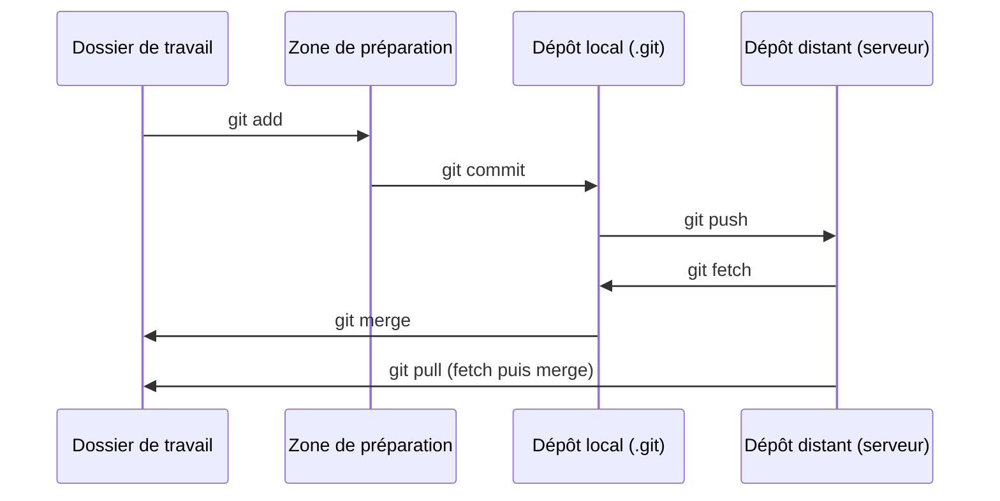
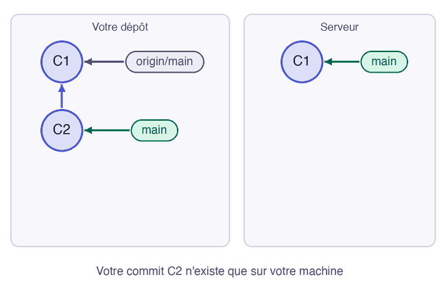

Vos deux postes sont identiques. Le second va maintenant ajouter un fichier et le publier, et le premier va le récupérer : c'est la boucle quotidienne du travail à plusieurs.

## 03.1 - Publier un commit depuis le second poste

Depuis `poste-b`, ajoutez le runbook, la fiche des procédures en cas d'incident, et enregistrez-le. `git status` signale que vous êtes en avance sur le serveur :

```exec
cd ~/layers-git/l3/poste-b && echo '# Runbook' > runbook.md
cd ~/layers-git/l3/poste-b && git add runbook.md && git commit -m "Ajoute le runbook"
cd ~/layers-git/l3/poste-b && git status
```

Le début de la réponse dit combien de commits restent à publier :

```text
On branch main
Your branch is ahead of 'origin/main' by 1 commit.
  (use "git push" to publish your local commits)
```

Le clone a déjà relié `main` à `origin/main`, donc un simple `git push` suffit :

```exec
cd ~/layers-git/l3/poste-b && git push
```

```verify
D=~/layers-git/l3
if ! git -C "$D/serveur.git" show main:runbook.md >/dev/null 2>&1; then
  echo "Le serveur n'a pas runbook.md. Depuis poste-b, faites le commit puis git push."
  exit 1
fi
echo "Le runbook est sur le serveur."
```

## 03.2 - Constater que le premier poste n'est pas au courant

Revenez sur `poste-a` et demandez son état :

```exec
cd ~/layers-git/l3/poste-a && git status
```

Git répond que tout est à jour, alors que le serveur a un commit de plus :

```text
On branch main
Your branch is up to date with 'origin/main'.
```

Il n'a pas menti : `git status` compare votre branche à la **dernière position connue** du serveur, sans le contacter. Pour rafraîchir cette information, il faut le lui demander.

## 03.3 - Télécharger sans rien changer avec git fetch

`git fetch` télécharge les nouveaux commits du serveur et met à jour `origin/main`. Il ne touche ni à votre branche, ni à vos fichiers :

```exec
cd ~/layers-git/l3/poste-a && git fetch
cd ~/layers-git/l3/poste-a && git status
```

Maintenant, Git sait que vous êtes en retard :

```text
On branch main
Your branch is behind 'origin/main' by 1 commit, and can be fast-forwarded.
  (use "git pull" to update your local branch)
```

Le graphe montre les deux positions, et votre dossier ne contient toujours pas `runbook.md` :

```exec
cd ~/layers-git/l3/poste-a && git log --oneline --all --graph
cd ~/layers-git/l3/poste-a && ls
```

Votre branche a un commit de retard sur `origin/main`, et `index.html` reste seul dans le dossier :

```text
* 145bff9 (origin/main, origin/HEAD) Ajoute le runbook
* 8387509 (HEAD -> main) Ajoute la page de statut
index.html
```

## 03.4 - Intégrer le travail avec git pull

`git pull` fait deux choses à la suite : un `git fetch`, puis la fusion de `origin/main` dans votre branche. C'est la même fusion que vous connaissez, et ici c'est une avance rapide (*fast-forward*) :

```exec
cd ~/layers-git/l3/poste-a && git pull
```

Git annonce une avance rapide :

```text
Updating 8387509..145bff9
Fast-forward
 runbook.md | 1 +
 1 file changed, 1 insertion(+)
 create mode 100644 runbook.md
```

Le fichier est maintenant dans votre dossier, et les deux postes sont au même point.

```verify
D=~/layers-git/l3
if [ ! -f "$D/poste-a/runbook.md" ]; then
  echo "poste-a n'a pas runbook.md. Lancez git pull depuis poste-a."
  exit 1
fi
echo "Le premier poste a récupéré le travail du second."
```

## 03.5 - Placer ces commandes dans le cycle de vie de Git

Le dépôt distant vient s'ajouter aux trois zones de votre machine. Ce schéma les relie toutes, de gauche à droite pour envoyer, de droite à gauche pour récupérer :



Cette animation enchaîne ces commandes entre votre dépôt et le serveur :



## Questions

```quiz
title: "Échanger avec le serveur"
tracksProgress: false
questions:
  - prompt: "Que fait `git fetch` ?"
    answers:
      - "Il envoie vos commits sur le serveur"
      - "Il télécharge les commits du serveur, sans changer votre branche ni vos fichiers"
      - "Il fusionne le travail du serveur dans votre branche"
    correct: 2
    explanation: "`git fetch` ne fait que télécharger et mettre à jour `origin/main`. C'est `git pull` qui ajoute la fusion."
  - prompt: "`git status` dit que vous êtes à jour. Le serveur peut-il quand même avoir de nouveaux commits ?"
    answers:
      - "Oui, car `git status` ne connaît que la dernière position vue"
      - "Non, `git status` interroge toujours le serveur"
    correct: 1
    explanation: "`git status` ne contacte pas le serveur. Il compare avec la dernière position connue."
```

> 📖 [`git fetch`](https://git-scm.com/docs/git-fetch) · [`git pull`](https://git-scm.com/docs/git-pull)
