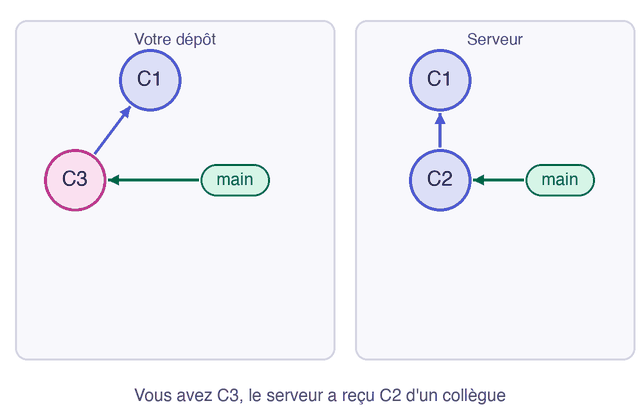

Deux personnes travaillent en même temps, et la seconde qui publie se fait refuser son envoi. C'est le message que vous verrez le plus souvent à plusieurs, et il protège le travail de vos collègues.

## 04.1 - Faire deux commits en parallèle

Sur `poste-a`, ajoutez une ligne à la page et publiez-la :

```exec
cd ~/byte-layers/git/l3/poste-a && echo '<p>API : OK</p>' >> index.html
cd ~/byte-layers/git/l3/poste-a && git commit -am "Affiche l'état de l'API"
cd ~/byte-layers/git/l3/poste-a && git push
```

Sur `poste-b`, qui n'a pas encore récupéré ce commit, modifiez un autre fichier et faites un commit :

```exec
cd ~/byte-layers/git/l3/poste-b && echo 'Alerte au bout de : 5 minutes' >> runbook.md
cd ~/byte-layers/git/l3/poste-b && git commit -am "Ajoute le seuil d'alerte"
```

## 04.2 - Lire le refus de git push

Tentez de publier depuis `poste-b`. La commande va échouer, et c'est ce qu'on veut observer :

```exec
cd ~/byte-layers/git/l3/poste-b && git push
```

Git refuse, et son message explique pourquoi :

```text
 ! [rejected]        main -> main (fetch first)
error: failed to push some refs to '/home/john/byte-layers/git/l3/serveur.git'
hint: Updates were rejected because the remote contains work that you do not
hint: have locally. This is usually caused by another repository pushing to
hint: the same ref. If you want to integrate the remote changes, use
hint: 'git pull' before pushing again.
```

Le serveur a un commit que vous n'avez pas. Accepter votre envoi ferait disparaître ce commit de la branche, donc Git s'y oppose. La bonne réaction est de récupérer ce travail d'abord.

> ⚠️ **N'utilisez pas `git push --force` pour passer outre.** Cette option remplace la branche du serveur par la vôtre, et le travail de vos collègues disparaît.

## 04.3 - Choisir comment réconcilier avec git pull --no-rebase

Quand les historiques ont divergé, un `git pull` sans option s'arrête et demande comment réunir les deux travaux. Vous pouvez le constater :

```exec
cd ~/byte-layers/git/l3/poste-b && git pull
```

Git vous demande de choisir, puis s'arrête :

```text
hint: You have divergent branches and need to specify how to reconcile them.
...
fatal: Need to specify how to reconcile divergent branches.
```

Votre branche et vos fichiers n'ont pas changé, seul `origin/main` a été mis à jour. L'option `--no-rebase` demande une fusion, celle que vous connaissez, et `--no-edit` accepte le message du commit de merge :

```exec
cd ~/byte-layers/git/l3/poste-b && git pull --no-rebase --no-edit
```

Le graphe montre la fourche et le commit de merge qui la referme :

```exec
cd ~/byte-layers/git/l3/poste-b && git log --oneline --all --graph
```

Vous pouvez maintenant publier, puisque votre branche contient tout ce que le serveur possède :

```exec
cd ~/byte-layers/git/l3/poste-b && git push
```

Si les deux commits avaient modifié les mêmes lignes, ce `git pull` aurait déclenché un conflit, à résoudre exactement comme pour un merge.

Cette animation résume la situation et sa résolution :



```verify
D=~/byte-layers/git/l3
if ! git -C "$D/serveur.git" show main:index.html | grep -q "API : OK"; then
  echo "Le serveur devrait avoir le commit de poste-a."
  exit 1
fi
if ! git -C "$D/serveur.git" show main:runbook.md | grep -q "5 minutes"; then
  echo "Le serveur n'a pas encore le seuil d'alerte. Depuis poste-b, lancez git pull --no-rebase --no-edit, puis git push."
  exit 1
fi
echo "Le serveur contient les deux travaux."
```

> 💡 **Remarque.** Pour ne plus avoir à préciser cette option, on peut fixer un choix une fois pour toutes avec `git config --global pull.rebase false`, qui correspond à la fusion. L'autre valeur, `true`, utilise le rebase, une autre façon de réunir deux historiques.

> 📖 [Note sur les fast-forwards, dans `git push`](https://git-scm.com/docs/git-push#_note_about_fast_forwards)
