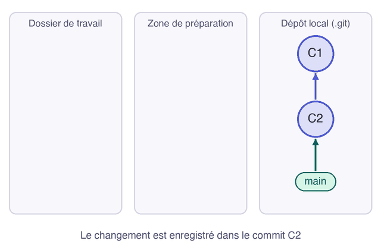

`git reset` déplace la branche sur un autre commit. Vers un commit plus ancien, il retire les commits suivants de l'historique. Il sert à reprendre un travail encore local. Ses trois modes diffèrent par ce qu'ils font de vos changements.

## 03.1 - Faire un commit à retirer

Ajoutez un commit, que vous allez retirer de trois façons différentes :

```exec
cd ~/byte-layers/git/l4-undo && echo '<p>Base : OK</p>' >> index.html
cd ~/byte-layers/git/l4-undo && git commit -am "Affiche l'état de la base"
cd ~/byte-layers/git/l4-undo && git log --oneline
```

La notation `HEAD~1` désigne le commit juste avant celui où vous êtes.

## 03.2 - Défaire le commit et garder le travail préparé avec --soft

Avec `--soft`, le commit disparaît et son contenu reste dans la zone de préparation, prêt à être enregistré autrement :

```exec
cd ~/byte-layers/git/l4-undo && git reset --soft HEAD~1
cd ~/byte-layers/git/l4-undo && git status --short
```

Le `M` en première colonne montre que le changement est préparé :

```text
M  index.html
```

Refaites le commit, avec un autre message :

```exec
cd ~/byte-layers/git/l4-undo && git commit -m "Affiche la base"
```

## 03.3 - Défaire le commit et garder le travail dans les fichiers avec --mixed

Sans option, `git reset` utilise le mode `--mixed` : le commit disparaît, et le changement reste dans vos fichiers, non préparé :

```exec
cd ~/byte-layers/git/l4-undo && git reset HEAD~1
cd ~/byte-layers/git/l4-undo && git status --short
```

Le `M` est maintenant en deuxième colonne :

```text
 M index.html
```

Refaites encore le commit :

```exec
cd ~/byte-layers/git/l4-undo && git commit -am "Affiche la base"
```

## 03.4 - Tout effacer avec --hard

Avec `--hard`, le commit disparaît, et vos fichiers reviennent à l'état du commit visé :

```exec
cd ~/byte-layers/git/l4-undo && git reset --hard HEAD~1
cd ~/byte-layers/git/l4-undo && cat index.html
```

La ligne sur la base a disparu :

```text
<h1>Statut des services</h1>
<p>API : OK</p>
```

> ⚠️ **`git reset --hard` efface aussi vos modifications non enregistrées**, sans demander confirmation. Lancez `git status` avant.

Ce tableau résume ce que deviennent vos changements selon le mode :

| Mode | Le commit | La zone de préparation | Vos fichiers |
|---|---|---|---|
| `--soft` | retiré | garde le changement | gardent le changement |
| `--mixed`, par défaut | retiré | vidée | gardent le changement |
| `--hard` | retiré | vidée | changement effacé |

Cette animation montre où se retrouve le changement avec chaque mode :



```verify
D=~/byte-layers/git/l4-undo
if grep -q "Base : OK" "$D/index.html"; then
  echo "index.html contient encore la ligne sur la base. Lancez git reset --hard HEAD~1."
  exit 1
fi
if [ -n "$(git -C "$D" status --porcelain)" ]; then
  echo "Il reste des changements non enregistrés. git status vous dira lesquels."
  exit 1
fi
echo "Le commit est retiré, et le dépôt est propre."
```

## Question

```quiz
prompt: "Vous voulez refaire votre dernier commit local, en gardant son contenu prêt à être enregistré. Quelle commande utilisez-vous ?"
answers:
  - "git reset --hard HEAD~1"
  - "git reset --soft HEAD~1"
  - "git restore index.html"
correct: 2
explanation: "`--soft` retire le commit et laisse son contenu dans la zone de préparation. `--hard` l'effacerait."
```

> 📖 [`git reset`](https://git-scm.com/docs/git-reset)
