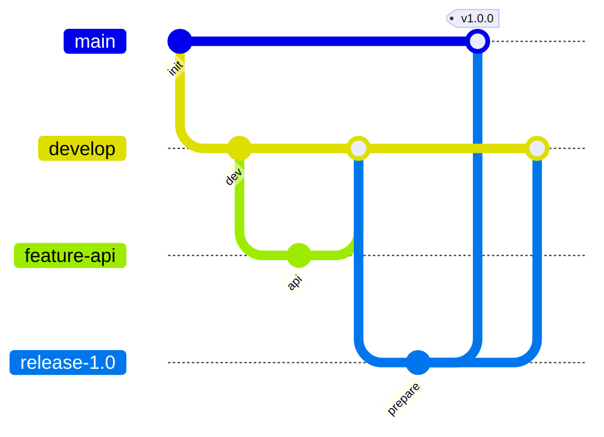
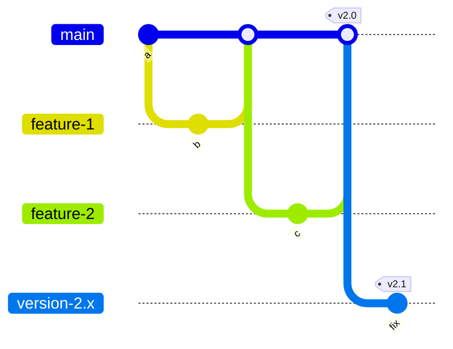

Un **workflow Git** est l'ensemble des règles que suit une équipe pour ses branches : lesquelles existent, qui fusionne où, et quand on publie une version. Gitflow et le trunk-based development sont les deux modèles les plus cités, et ils répondent à des besoins différents.

**Prérequis** : savoir créer et fusionner des branches et utiliser un dépôt distant, ce qu'enseignent [Travailler en parallèle avec les branches](https://byte-layers.com/fr/skills/git-branches-merge) et [Partager son travail avec un dépôt distant](https://byte-layers.com/fr/skills/git-remotes).

# Workflows Git : Gitflow et trunk-based development

Git n'impose aucune organisation. Sans convention commune, une équipe ne sait plus quelle branche est stable, ni à partir de quoi partir. Un workflow répond à ces questions une fois pour toutes.

## 1 - Gitflow : des branches par rôle

**Gitflow** donne un rôle à chaque type de branche. Deux branches vivent en permanence, et les autres sont temporaires :

| Branche | Durée de vie | Rôle |
|---|---|---|
| `main` | permanente | ce qui est en production, chaque version y porte un tag |
| `develop` | permanente | l'intégration de la prochaine version |
| `feature/*` | temporaire | une fonctionnalité, partie de `develop` et fusionnée dans `develop` |
| `release/*` | temporaire | la préparation d'une version, fusionnée dans `main` et dans `develop` |
| `hotfix/*` | temporaire | un correctif urgent, parti de `main` et fusionné dans `main` et dans `develop` |

Le schéma suivant montre une fonctionnalité, puis la sortie d'une version :

Ce modèle convient bien à un produit livré par versions planifiées. Son coût est un grand nombre de fusions, et des branches qui s'éloignent les unes des autres.

## 2 - Trunk-based development : une seule branche de référence

Dans le **trunk-based development** (TBD), toute l'équipe intègre très souvent dans une seule branche, le tronc, généralement `main`. Les branches de travail durent quelques heures, au plus un ou deux jours :

Les petites fusions fréquentes réduisent fortement les conflits. En contrepartie, le tronc doit rester livrable à tout moment, ce qui suppose des tests automatisés solides. Quand il faut maintenir une ancienne version, on crée à partir de son tag une branche comme `version/2.x`, et on y reporte les correctifs.

## 3 - Choisir selon le rythme de livraison et la maturité de l'équipe

Aucun modèle ne gagne dans l'absolu. Ces critères décident du choix :

| Ce qui compte | Plutôt Gitflow | Plutôt trunk-based |
|---|---|---|
| Le rythme de livraison | versions planifiées | livraison continue |
| Les tests automatisés | partiels | solides, et lancés à chaque changement |
| Plusieurs versions à maintenir | oui, de façon organisée | possible, avec des branches de version |
| L'expérience de l'équipe | hétérogène | habituée à de petits changements |

L'auteur de Gitflow, Vincent Driessen, recommande lui-même une méthode plus simple pour les applications livrées en continu.

> 💡 **Remarque.** Entre les deux, le **GitHub Flow** se contente de `main` et de branches de fonctionnalité fusionnées après relecture. Beaucoup d'équipes l'adoptent, sous ce nom ou non.

## 4 - Nommer ses commits et ses branches

Quel que soit le modèle, une convention de nommage rend l'historique lisible. Beaucoup d'équipes préfixent leurs branches, comme `feature/42-etat-base`, et leurs messages par le type de changement, comme `fix: corrige le seuil d'alerte`. La spécification **Conventional Commits** formalise cette pratique, et les émojis de **gitmoji** en sont une variante.

## Récap

- Un workflow fixe les règles d'une équipe pour ses branches et ses versions.
- Gitflow donne un rôle à chaque branche, et convient aux versions planifiées.
- Le trunk-based development intègre très souvent dans une seule branche, et suppose de bons tests.
- Le choix dépend du rythme de livraison, des tests et des versions à maintenir.

> 📖 [L'article d'origine de Gitflow](https://nvie.com/posts/a-successful-git-branching-model/) · [trunkbaseddevelopment.com](https://trunkbaseddevelopment.com/) · [Comparaison de workflows, par Atlassian](https://www.atlassian.com/git/tutorials/comparing-workflows) · [Conventional Commits](https://www.conventionalcommits.org/fr/v1.0.0/) · [gitmoji](https://gitmoji.dev/)
