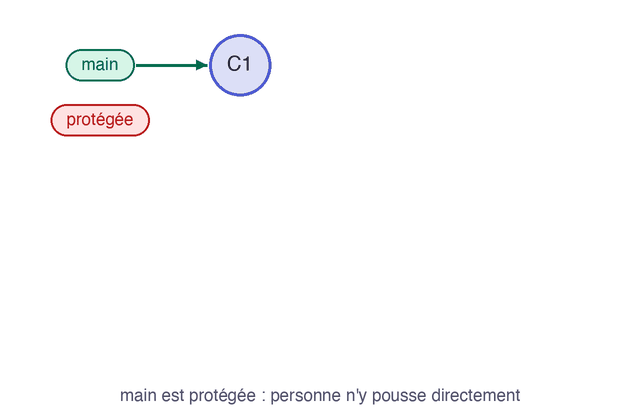

La merge request est ouverte, et votre travail n'est pas encore sur `main`. Elle sert d'abord à faire relire le changement.

## 03.1 - Relire le changement

Dans la merge request, l'onglet **Changes** montre les lignes modifiées. Survolez une ligne et cliquez sur l'icône de commentaire pour laisser une remarque. Dans une équipe, on distingue souvent la **revue technique** du code et la **revue fonctionnelle** du résultat. Le bouton **Approve** indique que vous êtes d'accord : sur l'offre gratuite, il reste facultatif.

## 03.2 - Fusionner et voir l'issue se fermer

Sur l'onglet **Overview**, laissez **Delete source branch** coché, puis cliquez sur **Merge**. Le code arrive sur `main`, la branche est supprimée sur le serveur, et l'issue `#1` passe à l'état fermé.

Cette animation résume le chemin parcouru :



Mettez à jour votre poste :

```exec
cd ~/byte-layers/git/gitlab-mr/statuspage && git switch main && git pull
cd ~/byte-layers/git/gitlab-mr/statuspage && ls
```

```verify
C=$(cat ~/byte-layers/git/gitlab-mr/url 2>/dev/null)
if [ -z "$C" ]; then
  echo "L'adresse du projet n'est pas enregistrée dans ~/byte-layers/git/gitlab-mr/url."
  exit 1
fi
case "$C" in
  git@*) H="https://$(echo "$C" | sed -E 's#git@([^:]+):.*#\1#')"; P=$(echo "$C" | sed -E 's#git@[^:]+:##') ;;
  *) H=$(echo "$C" | sed -E 's#^(https?://)([^/@]*@)?([^/]+)/.*#\1\3#'); P=$(echo "$C" | sed -E 's#^https?://[^/]+/##') ;;
esac
P=$(echo "$P" | sed -E 's#\.git$##; s#/#%2F#g')
A="$H/api/v4/projects/$P"
if ! curl -fsS "$A/merge_requests?state=merged" 2>/dev/null | grep -q '"source_branch":"feature/1-page-statut"'; then
  echo "La merge request n'est pas encore fusionnée."
  exit 1
fi
if ! curl -fsS "$A/issues?state=closed" 2>/dev/null | grep -q '"type":"ISSUE"'; then
  echo "L'issue n'est pas fermée. Le message du commit doit contenir Closes suivi de son numéro."
  exit 1
fi
if [ ! -f ~/byte-layers/git/gitlab-mr/statuspage/index.html ]; then
  echo "index.html n'est pas encore sur votre poste. Lancez git pull depuis main."
  exit 1
fi
echo "Le code est sur main, et l'issue est fermée."
```
