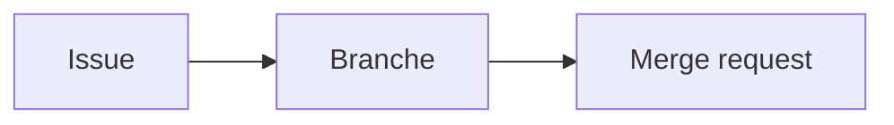

Le **wiki** d'un projet accueille une documentation éditable en ligne, en Markdown. Il est séparé du code.

## 03.1 - Créer une page de wiki

Dans **Plan**, ouvrez **Wiki**, puis créez une page intitulée `Accueil`. Écrivez deux lignes sur le projet, et validez.

Vous pouvez y insérer un schéma écrit en texte, que GitLab dessine grâce à **Mermaid** :

````markdown

````

```verify
C=$(cat ~/layers-git/gitlab-plan/url 2>/dev/null)
if [ -z "$C" ]; then
  echo "L'adresse du projet n'est pas enregistrée dans ~/layers-git/gitlab-plan/url."
  exit 1
fi
case "$C" in
  git@*) H="https://$(echo "$C" | sed -E 's#git@([^:]+):.*#\1#')"; P=$(echo "$C" | sed -E 's#git@[^:]+:##') ;;
  *) H=$(echo "$C" | sed -E 's#^(https?://)([^/@]*@)?([^/]+)/.*#\1\3#'); P=$(echo "$C" | sed -E 's#^https?://[^/]+/##') ;;
esac
P=$(echo "$P" | sed -E 's#\.git$##; s#/#%2F#g')
A="$H/api/v4/projects/$P"
if ! curl -fsS "$A/wikis" 2>/dev/null | grep -q '"slug"'; then
  echo "Le wiki ne contient aucune page."
  exit 1
fi
echo "Le wiki a sa première page."
```

## 03.2 - Choisir entre le wiki et le dépôt

Les deux accueillent de la documentation, et le choix dépend de qui la lit et de la façon dont elle évolue :

| Où | Convient pour | Limite |
|---|---|---|
| Fichiers Markdown du dépôt | une documentation liée au code, relue avec lui | il faut un accès au code |
| Wiki | des informations de projet, éditées librement | peu relié aux versions du code |

## 03.3 - Ranger le dossier de ce lab

Vous pouvez aussi supprimer le projet sur GitLab, depuis **Settings**, **General**, **Advanced**, **Delete project**.

```exec
cd ~ && rm -rf ~/layers-git/gitlab-plan
```

```verify
if [ -e ~/layers-git/gitlab-plan ]; then
  echo "Le dossier ~/layers-git/gitlab-plan existe encore."
  exit 1
fi
echo "Le dossier est supprimé."
```

## Récap

- Les labels classent, les jalons donnent une échéance, et les issues décrivent le travail.
- Un tableau affiche les issues en colonnes, et déplacer une carte modifie ses labels.
- Le wiki accueille la documentation de projet, et le dépôt celle qui suit le code.

> 📖 [Wiki](https://docs.gitlab.com/user/project/wiki/)
