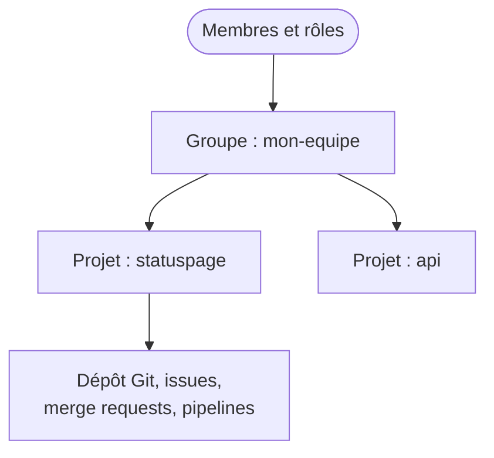

GitLab héberge vos dépôts Git et ajoute autour d'eux ce dont une équipe a besoin : la gestion des tâches, la relecture du code et l'automatisation. Vous saurez comment la plateforme est organisée, et où trouver chaque fonction.

**Prérequis** : savoir ce qu'est un dépôt distant, ce qu'enseigne [Partager son travail avec un dépôt distant](https://byte-layers.com/fr/skills/git-remotes).

# GitLab : la plateforme autour de vos dépôts

**GitLab** est une plateforme web de gestion de projets logiciels, construite autour de Git. Git reste l'outil qui versionne vos fichiers, et GitLab le serveur où l'équipe se retrouve.

## 1 - Ce que GitLab ajoute à Git

Git ne connaît ni les tâches, ni les relectures, ni les droits. GitLab apporte ces fonctions, que voici :

| Besoin | Fonction de GitLab |
|---|---|
| Héberger le code et donner des droits | groupes, projets, membres et rôles |
| Organiser le travail | issues, labels, jalons, tableaux, wiki |
| Relire et protéger le code | branches protégées, merge requests |
| Automatiser les tests et la livraison | pipelines CI/CD |

## 2 - GitLab.com ou une instance installée, gratuit ou payant

Deux choix sont à distinguer. Le premier porte sur l'endroit où tourne GitLab : **gitlab.com** est le service en ligne, et une instance **autogérée** (*self-managed*) est un GitLab installé sur vos propres serveurs. Le second porte sur l'offre : l'édition **Free** suffit pour apprendre ces bases, et les offres payantes ajoutent notamment des règles d'approbation obligatoires. Vérifiez les conditions et limites actuelles sur la [page des tarifs](https://about.gitlab.com/pricing/).

## 3 - Groupes, projets et membres

GitLab range tout dans une hiérarchie. Un **projet** contient un dépôt Git et ses tâches. Un **groupe** rassemble plusieurs projets et leurs membres, et les droits donnés sur un groupe s'appliquent à tous ses projets.

## 4 - Se repérer dans le menu d'un projet

Le menu de gauche d'un projet regroupe les fonctions par activité. Les libellés sont en anglais par défaut, et peuvent évoluer d'une version à l'autre :

| Menu | Ce que vous y trouvez |
|---|---|
| **Manage** | membres, labels, activité |
| **Plan** | tableaux d'issues, jalons, wiki |
| **Work items** | issues et autres tâches, épinglé en haut du menu |
| **Code** | dépôt, commits, branches, merge requests, tags |
| **Build** | pipelines, jobs, éditeur de pipeline |
| **Settings** | réglages du projet, dont les branches protégées |

Le champ **Search or go to** en haut de page retrouve aussi une page par son nom.

## Récap

- GitLab héberge vos dépôts Git et ajoute tâches, relecture, droits et automatisation.
- gitlab.com et une instance autogérée offrent les mêmes fonctions de base.
- Les groupes rassemblent des projets, et leurs droits s'appliquent à tous ces projets.

> 📖 [Documentation de GitLab](https://docs.gitlab.com/) · [Groupes](https://docs.gitlab.com/user/group/) · [Projets](https://docs.gitlab.com/user/project/)
