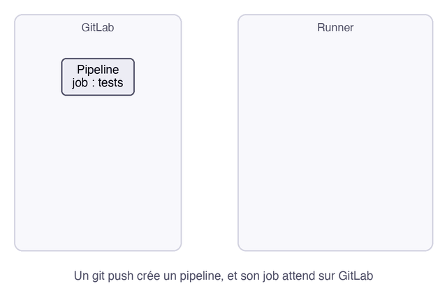

Un runner est le programme qui exécute réellement les jobs d'un pipeline. GitLab décide quoi faire, et le runner le fait, sur une autre machine.

**Prérequis** : savoir ce qu'est un pipeline, ce qu'explique [CI/CD : automatiser les tests et la livraison](https://byte-layers.com/fr/bits/ci-cd-why).

# Les runners : qui exécute vos pipelines

Un **job** est une tâche du pipeline, comme lancer les tests. Un **runner** est un agent qui se connecte à GitLab, récupère les jobs et les exécute.

## 1 - Comment un job arrive sur un runner

C'est le runner qui interroge GitLab à intervalles réguliers. Il n'a donc pas besoin d'être joignable depuis l'extérieur, ce qui permet d'en installer un sur un réseau privé. Cette animation montre la vie d'un job :



Le mode d'exécution s'appelle l'**executor**. Avec l'executor `docker`, le plus courant, chaque job tourne dans un conteneur neuf, créé pour lui à partir de l'image que vous choisissez.

## 2 - Runners partagés ou runners à vous

| Type | Qui l'héberge | Quand le choisir |
|---|---|---|
| Runner partagé de gitlab.com | GitLab | pour démarrer sans rien installer, dans la limite de vos quotas |
| Runner de groupe ou de projet | vous | pour exécuter les jobs chez vous, ou accéder à votre réseau |

Avec un runner partagé, vos jobs tournent sur des machines tierces : à prendre en compte pour du code ou des secrets sensibles.

## 3 - Cibler un runner avec des tags

Un runner peut porter des **tags**, sans rapport avec les tags Git, et un job les demande avec le mot-clé `tags:`. Le job ira alors sur un runner qui les possède tous :

```yaml
build-windows:
  tags:
    - windows
  script:
    - dir
```

Sans `tags:`, le job part sur un runner qui accepte les jobs sans tag, ce que font les runners partagés de gitlab.com.

## Récap

- Le runner exécute les jobs, et c'est lui qui contacte GitLab.
- Avec l'executor `docker`, chaque job part d'un conteneur neuf.
- Les tags choisissent le runner qui prend un job.

> 📖 [GitLab Runner](https://docs.gitlab.com/runner/) · [Runners hébergés par GitLab](https://docs.gitlab.com/ci/runners/) · [Executors](https://docs.gitlab.com/runner/executors/)
