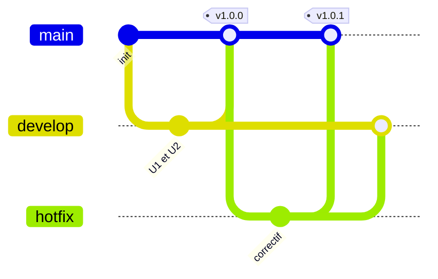

`develop` contient la version à livrer. Avec des branches protégées, chaque passage se fait par une merge request. Ce schéma résume le trajet des branches dans Gitflow :



## 03.1 - Publier la version 1.0.0

Ouvrez une merge request de `develop` vers `main`. `develop` étant la branche par défaut, cliquez sur **Change branches** sur le formulaire pour choisir la cible `main`. **Décochez** **Delete source branch**, car `develop` doit rester. Fusionnez-la. Mettez ensuite à jour le poste A, et posez le tag de la version :

```exec
cd ~/byte-layers/git/gitlab-team/poste-a && git fetch && git switch main && git pull
cd ~/byte-layers/git/gitlab-team/poste-a && git tag -a v1.0.0 -m "Version 1.0.0" && git push origin v1.0.0
```

```verify
C=$(cat ~/byte-layers/git/gitlab-team/url 2>/dev/null)
if [ -z "$C" ]; then
  echo "L'adresse du projet n'est pas enregistrée dans ~/byte-layers/git/gitlab-team/url."
  exit 1
fi
case "$C" in
  git@*) H="https://$(echo "$C" | sed -E 's#git@([^:]+):.*#\1#')"; P=$(echo "$C" | sed -E 's#git@[^:]+:##') ;;
  *) H=$(echo "$C" | sed -E 's#^(https?://)([^/@]*@)?([^/]+)/.*#\1\3#'); P=$(echo "$C" | sed -E 's#^https?://[^/]+/##') ;;
esac
P=$(echo "$P" | sed -E 's#\.git$##; s#/#%2F#g')
A="$H/api/v4/projects/$P"
if ! curl -fsS "$A/repository/tags" 2>/dev/null | grep -q '"name":"v1.0.0"'; then
  echo "Le tag v1.0.0 n'est pas sur le serveur."
  exit 1
fi
if ! curl -fsS "$A/repository/files/src%2Flog.txt/raw?ref=main" 2>/dev/null | grep -q 'Hello from U2'; then
  echo "main ne contient pas encore le travail de develop."
  exit 1
fi
echo "La version 1.0.0 est publiée sur main."
```

## 03.2 - Livrer un hotfix

Un bug est signalé en production. Le correctif part du tag, et doit rejoindre `main` et `develop` :

```exec
cd ~/byte-layers/git/gitlab-team/poste-a && git switch -c hotfix/1.0.1 v1.0.0
cd ~/byte-layers/git/gitlab-team/poste-a && echo 'Correctif urgent' > src/hotfix.txt && git add src/hotfix.txt && git commit -m "Corrige le bug en production"
cd ~/byte-layers/git/gitlab-team/poste-a && git push -u origin hotfix/1.0.1
```

## 03.3 - Publier le correctif et le reporter dans develop

Sur GitLab, ouvrez une merge request de `hotfix/1.0.1` vers `main`, avec **Change branches** pour choisir cette cible, en décochant **Delete source branch**, et fusionnez-la. Taguez ensuite la nouvelle version :

```exec
cd ~/byte-layers/git/gitlab-team/poste-a && git switch main && git pull
cd ~/byte-layers/git/gitlab-team/poste-a && git tag -a v1.0.1 -m "Version 1.0.1" && git push origin v1.0.1
```

Ouvrez enfin une merge request de `hotfix/1.0.1` vers `develop`, cette fois avec **Delete source branch** coché, et fusionnez-la.

```verify
C=$(cat ~/byte-layers/git/gitlab-team/url 2>/dev/null)
if [ -z "$C" ]; then
  echo "L'adresse du projet n'est pas enregistrée dans ~/byte-layers/git/gitlab-team/url."
  exit 1
fi
case "$C" in
  git@*) H="https://$(echo "$C" | sed -E 's#git@([^:]+):.*#\1#')"; P=$(echo "$C" | sed -E 's#git@[^:]+:##') ;;
  *) H=$(echo "$C" | sed -E 's#^(https?://)([^/@]*@)?([^/]+)/.*#\1\3#'); P=$(echo "$C" | sed -E 's#^https?://[^/]+/##') ;;
esac
P=$(echo "$P" | sed -E 's#\.git$##; s#/#%2F#g')
A="$H/api/v4/projects/$P"
if ! curl -fsS "$A/repository/tags" 2>/dev/null | grep -q '"name":"v1.0.1"'; then
  echo "Le tag v1.0.1 n'est pas sur le serveur."
  exit 1
fi
if ! curl -fsS "$A/repository/files/src%2Fhotfix.txt?ref=develop" >/dev/null 2>&1; then
  echo "develop ne contient pas le correctif."
  exit 1
fi
echo "Le correctif est sur main et sur develop."
```

## 03.4 - Ranger le dossier de ce lab

Vous pouvez aussi supprimer le projet sur GitLab, depuis **Settings**, **General**, **Advanced**, **Delete project**.

```exec
cd ~ && rm -rf ~/byte-layers/git/gitlab-team
```

```verify
if [ -e ~/byte-layers/git/gitlab-team ]; then
  echo "Le dossier ~/byte-layers/git/gitlab-team existe encore."
  exit 1
fi
echo "Le dossier est supprimé."
```

## Récap

- Avec des branches protégées, chaque fusion passe par une merge request.
- Une branche permanente se fusionne sans cocher **Delete source branch**.
- Une version se marque par un tag, envoyé sur le serveur.
- Un hotfix part de la production, et rejoint `main` puis `develop`.

Pour vous tester sans guide, faites le challenge [Mener un projet GitLab, sans guide](https://byte-layers.com/fr/challenges/gitlab-team-workflow-challenge).

> 📖 [Tags](https://docs.gitlab.com/user/project/repository/tags/) · [Workflow Gitflow, par Atlassian](https://www.atlassian.com/git/tutorials/comparing-workflows/gitflow-workflow)
