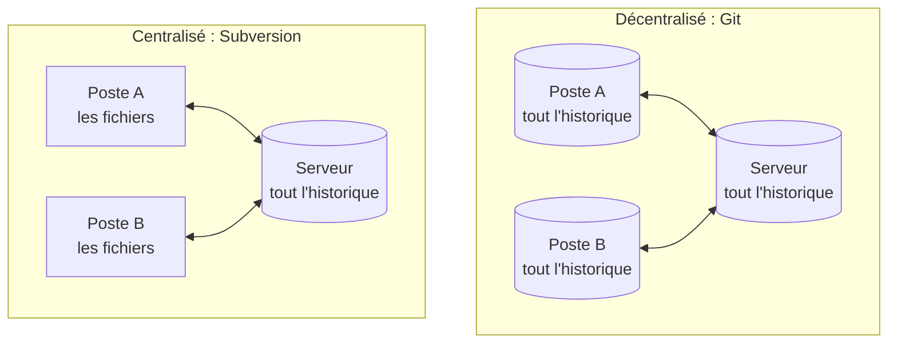

Un dossier partagé finit toujours par contenir `runbook-final.md`, `runbook-final-v2.md` et `runbook-final-v2-relu-OK.md`. Un gestionnaire de versions résout ce problème en gardant chaque état des fichiers et son histoire. Git le fait sans dépendre d'un serveur, à la différence des outils qui l'ont précédé.

**Prérequis** : aucun, si ce n'est d'avoir déjà travaillé sur un fichier à plusieurs.

# Pourquoi versionner son travail

Un **gestionnaire de versions** (en anglais *version control system*, ou VCS) enregistre les états successifs d'un ensemble de fichiers. Il garde pour chaque état ce qui a changé, qui l'a changé, quand et pourquoi. Git est aujourd'hui le plus répandu d'entre eux, et un ensemble de fichiers suivi par Git s'appelle un **dépôt**.

## 1 - Les questions qu'un dossier partagé ne sait pas résoudre

Prenons une équipe qui tient à jour deux fichiers : une page de statut, `index.html`, qui affiche l'état de ses services, et un runbook, `runbook.md`, qui décrit la marche à suivre en cas d'incident. L'un est du code et l'autre de la documentation, mais tous deux sont du texte, et ils posent les mêmes questions :

| Question | Sans outil | Avec un gestionnaire de versions |
|---|---|---|
| Qui a changé ce seuil d'alerte, et pourquoi ? | on demande autour de soi | chaque modification porte un auteur, une date et un message |
| La page marchait hier, qu'est-ce qui a changé ? | on compare à l'œil deux copies | l'outil montre les lignes modifiées entre deux états |
| Comment revenir à la version d'avant ? | on espère avoir gardé une copie | tous les états restent disponibles |
| Deux personnes modifient le même fichier : qui gagne ? | la dernière enregistrée écrase l'autre | l'outil réunit les deux, et signale ce qu'il ne sait pas trancher |

## 2 - Git n'est pas GitHub

Le mot revient sans cesse, et il désigne deux choses qu'il faut séparer. **Git** est le logiciel installé sur une machine, par exemple votre poste, libre et gratuit, créé en 2005 par Linus Torvalds pour le développement du noyau Linux. **GitHub ou GitLab** sont des plateformes qui hébergent des dépôts Git et ajoutent une interface web, de la gestion de tâches et de l'automatisation. Git fonctionne très bien sans aucune d'elles.

## 3 - Git compare des lignes de texte

Git montre ce qui a changé ligne par ligne, ce qui marche pour tout ce qui s'écrit en texte : du code, de la configuration, du Markdown. 
> 💡 **Remarque : les gros fichiers binaires.** Une vidéo, un PDF ou une image restent versionnables, mais Git ne sait pas y montrer une différence, et chaque version alourdit le dépôt. Pour ces fichiers, il existe des outils dédiés, comme l'extension [Git LFS](https://git-lfs.com/).

## 4 - Un système centralisé ou décentralisé

La différence entre les générations d'outils tient à l'endroit où vit l'historique. Le schéma ci-dessous met face à face Subversion (SVN), un outil **centralisé** encore rencontré en entreprise, et Git, un outil **décentralisé**, ou **distribué**, les deux mots désignant la même chose.

Avec un outil centralisé, consulter l'historique ou enregistrer une version passe par le serveur. Avec Git, chaque poste possède une copie complète de l'historique : on enregistre et on compare sans réseau, puis on partage quand on le décide.

Ce choix a une contrepartie. SVN sait donner des droits par dossier, alors que Git n'a pas de gestion de droits : ce sont les plateformes qui en ajoutent, le plus souvent dépôt par dépôt. Quand une équipe doit isoler une partie du travail, elle la place en général dans un autre dépôt.

## Récap

- Un gestionnaire de versions garde chaque état de vos fichiers, avec son auteur, sa date et sa raison.
- Git convient à tout ce qui s'écrit en texte, code comme documentation.
- Git est décentralisé, ou distribué : chaque poste a l'historique complet.
- Git est l'outil, GitHub et GitLab sont des plateformes construites autour de lui.

> 📖 [À propos de la gestion de version, dans le livre Pro Git](https://git-scm.com/book/fr/v2/D%C3%A9marrage-rapide-%C3%80-propos-de-la-gestion-de-version)
